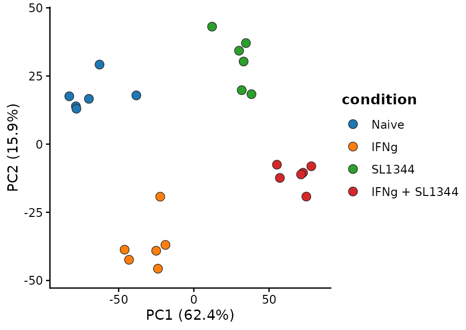
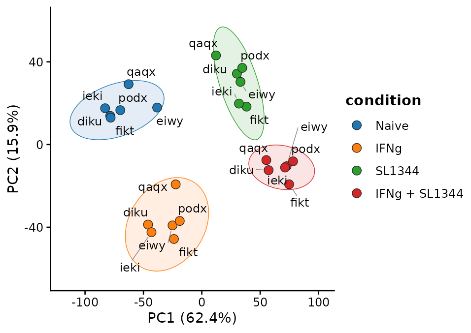
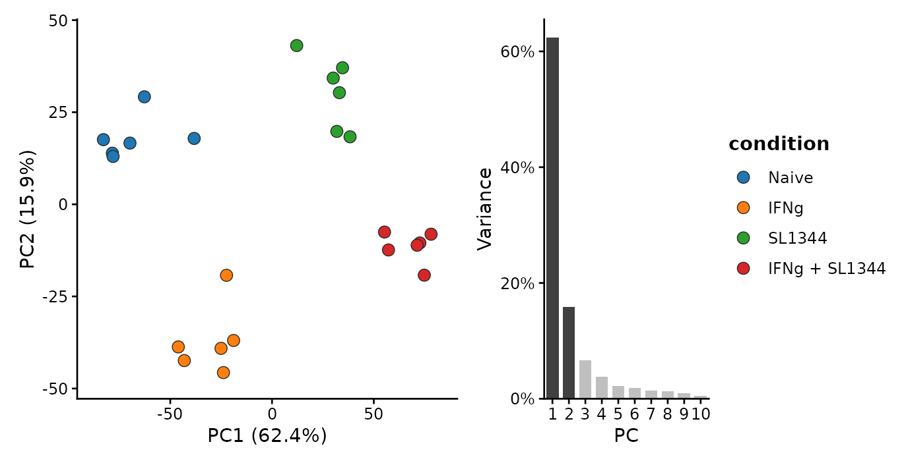
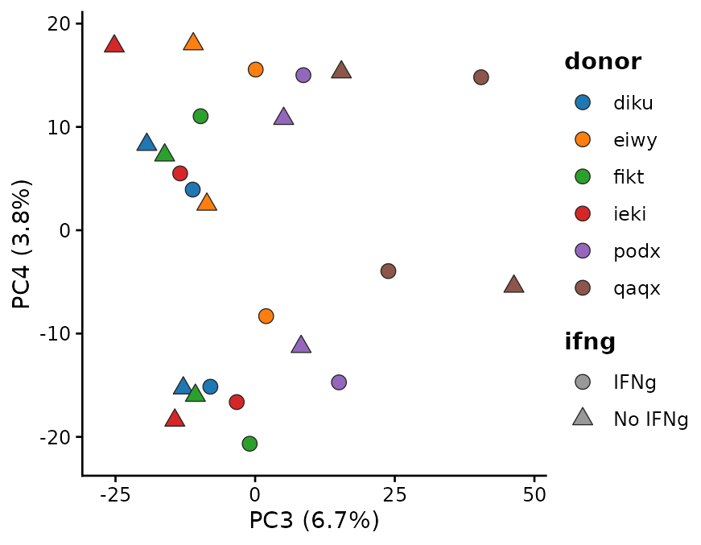
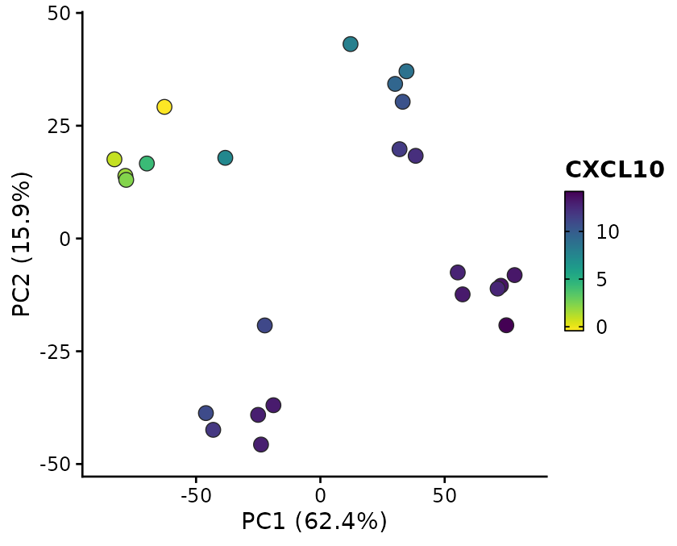
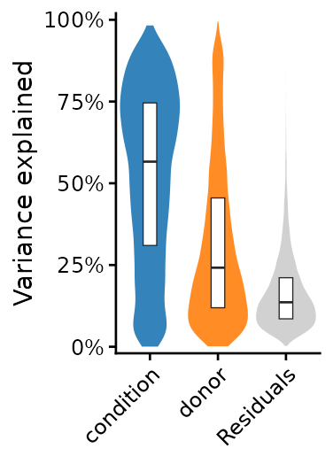
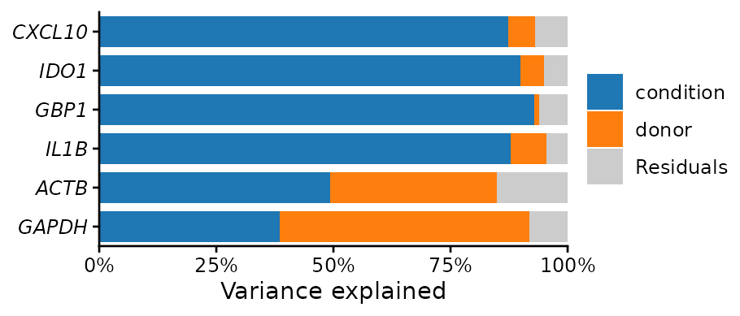
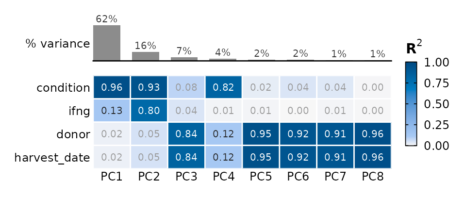
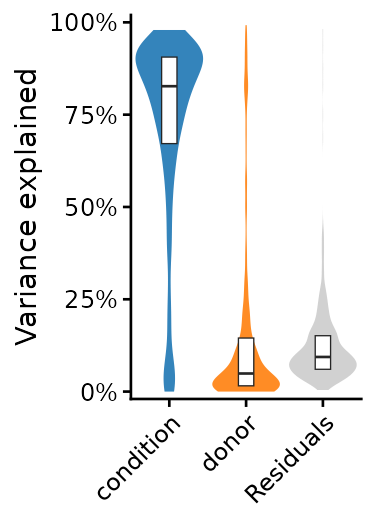
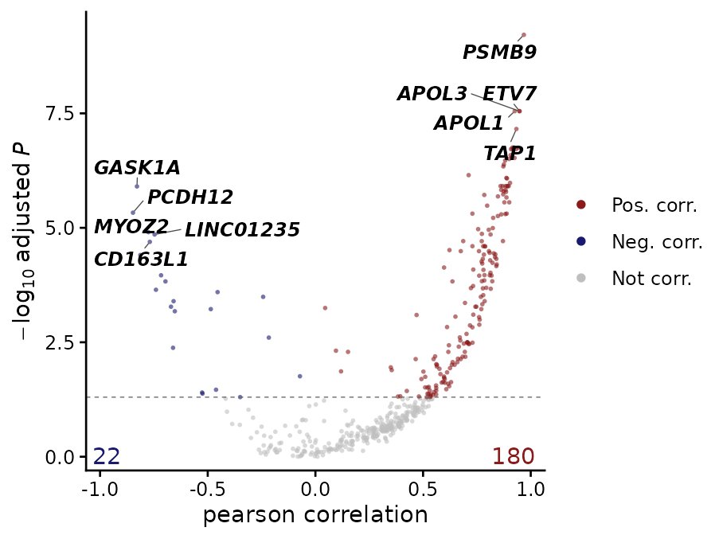

# Bulk RNA-seq: samples and structure

**Question:** before testing anything, what separates the samples, and
is it the biology or something else (donor, batch, library size)?

| Function | Use |
|----|----|
| [`keywords_to_info()`](https://j-y26.github.io/bioToolkit/reference/keywords_to_info.md) | sample annotation from sample names |
| [`filter_low_expression_genes()`](https://j-y26.github.io/bioToolkit/reference/filter_low_expression_genes.md) | drop genes too lowly expressed to be informative |
| [`plot_pca()`](https://j-y26.github.io/bioToolkit/reference/plot_pca.md) | samples on principal components |
| [`extract_pc_loadings()`](https://j-y26.github.io/bioToolkit/reference/extract_pc_loadings.md) | genes driving each PC |
| [`plot_variance_explained()`](https://j-y26.github.io/bioToolkit/reference/plot_variance_explained.md) | how much of the variation each covariate explains |
| [`summarize_group_expression()`](https://j-y26.github.io/bioToolkit/reference/summarize_group_expression.md) | mean (or other summary) per group, e.g. for heatmaps |
| [`calc_expr_corr()`](https://j-y26.github.io/bioToolkit/reference/calc_expr_corr.md) | genes correlated with a gene of interest, adjusting for covariates |

**Data:** iPSC-derived macrophages of 6 donors, each naive, stimulated
with interferon-γ (IFNg), infected with *Salmonella* (SL1344), or both
([Alasoo et al. 2018](https://doi.org/10.1038/s41588-018-0046-7);
gene-level counts from the Bioconductor package *macrophage*). The
sample table also records two processing dates, which are shared by the
four samples of a donor.

``` r

mac <- docs_macrophage()
counts <- mac$counts
dim(counts)
#> [1] 26024    24
head(mac$samples[c("donor", "harvest_date", "extraction_date")], 4)
#>                  donor harvest_date extraction_date
#> diku_naive        diku    11/6/2015      11/30/2015
#> diku_IFNg         diku    11/6/2015      11/30/2015
#> diku_SL1344       diku    11/6/2015      11/30/2015
#> diku_IFNg_SL1344  diku    11/6/2015      11/30/2015
```

## Annotating samples from their names

[`keywords_to_info()`](https://j-y26.github.io/bioToolkit/reference/keywords_to_info.md)
maps a sample name to a value by regular-expression keywords: the first
keyword found wins, so list specific patterns before general ones (here
“IFNg_SL1344” before “IFNg”):

``` r

keywords <- c("IFNg_SL1344", "IFNg", "SL1344", "naive")
labels <- c("IFNg + SL1344", "IFNg", "SL1344", "Naive")
# Vectorized over sample names
condition <- keywords_to_info(
    colnames(counts),
    keywords = keywords,
    info = labels
)
condition_levels <- c("Naive", "IFNg", "SL1344", "IFNg + SL1344")
samples <- data.frame(
    donor = mac$samples$donor,
    condition = factor(unname(condition), levels = condition_levels),
    harvest_date = mac$samples$harvest_date,
    row.names = colnames(counts)
)
table(samples$condition)
#> 
#>         Naive          IFNg        SL1344 IFNg + SL1344 
#>             6             6             6             6
```

## Filtering and normalizing

[`filter_low_expression_genes()`](https://j-y26.github.io/bioToolkit/reference/filter_low_expression_genes.md)
keeps genes with at least 1 count per million (CPM) in at least
`min_group_size` samples. Set it to the size of the smallest group of
interest (here 6 samples per condition), so a gene expressed in only one
condition is kept:

``` r

counts_f <- filter_low_expression_genes(counts, min_group_size = 6)
c(before = nrow(counts), after = nrow(counts_f))
#> before  after 
#>  26024  13303
```

The plots below take normalized, log-scale values (here edgeR’s
TMM-normalized log2 CPM; DESeq2’s `vst()` works the same way). Raw
counts would mostly show library size and the few most abundant genes.

``` r

y <- edgeR::normLibSizes(edgeR::DGEList(counts_f))
logcpm <- edgeR::cpm(y, log = TRUE, prior.count = 2)
```

## PCA

[`plot_pca()`](https://j-y26.github.io/bioToolkit/reference/plot_pca.md)
takes the normalized matrix (and runs a PCA on the `n.top` = 500 most
variable genes, as
[`DESeq2::plotPCA()`](https://rdrr.io/pkg/BiocGenerics/man/plotPCA.html))
or a `prcomp` result:

``` r

plot_pca(logcpm, samples, color.by = "condition")
#> PCA of 500 features x 24 samples
```



PC1 (62% of the variance) separates *Salmonella*-infected from
uninfected macrophages, PC2 (16%) IFN-γ-stimulated from unstimulated
ones: the two treatments dominate the variation.

### Variants

- `ellipse` and `label.by`
- `scree`
- `dims` and `shape.by`
- Continuous colour

95% ellipses (multivariate *t*) per group of at least 4 samples, and
sample labels:

``` r

plot_pca(
    logcpm,
    samples,
    color.by = "condition",
    ellipse = TRUE,
    label.by = "donor"
)
```



The % variance of the first PCs, with the plotted ones in dark:

``` r

plot_pca(logcpm, samples, color.by = "condition", scree = TRUE)
```



Later PCs often carry the second-order structure, here the donors.
`shape.by` takes a covariate of at most 5 levels:

``` r

samples$ifng <- ifelse(grepl("IFNg", samples$condition), "IFNg", "No IFNg")
plot_pca(
    logcpm,
    samples,
    color.by = "donor",
    shape.by = "ifng",
    dims = c(3, 4)
)
```



A numeric covariate gets a continuous scale, e.g. a gene of interest:

``` r

samples$CXCL10 <- logcpm["CXCL10", rownames(samples)]
plot_pca(logcpm, samples, color.by = "CXCL10", cols = "viridis_r")
```



### Genes behind the PCs

[`extract_pc_loadings()`](https://j-y26.github.io/bioToolkit/reference/extract_pc_loadings.md)
returns the genes with the largest absolute loadings on each PC of a
`prcomp` result:

``` r

top500 <- order(apply(logcpm, 1, var), decreasing = TRUE)[1:500]
pca <- prcomp(t(logcpm[top500, ]))
loadings <- extract_pc_loadings(pca, pcs = 1:2, top_n = 8)
# One element per PC: PC_1, PC_2, ...
loadings$PC_1
#>      IL12B       CCR7      IL23A       CSF3      IFNL1      IL36G      CCL20 
#> 0.10194798 0.09852192 0.09733031 0.09380510 0.09337377 0.09136720 0.08534562 
#>   C11orf96 
#> 0.08509119
```

The same `prcomp` result can be plotted with
`plot_pca(pca, samples, ...)`.

## What drives the variation

[`plot_variance_explained()`](https://j-y26.github.io/bioToolkit/reference/plot_variance_explained.md)
splits each gene’s variance between covariates. The built-in method fits
a linear model per gene and shares its R² between the covariates by the
LMG method, so the fractions sum to 1 with the residuals and do not
depend on the order of the covariates.

``` r

plot_variance_explained(logcpm, samples, covariates = c("condition", "donor"))
```



Condition explains about half of the variance of a typical gene (median
across genes), donor about a quarter. The processing dates are shared by
all samples of a donor, so they are fully confounded with donor and
cannot be separated from it (the function stops with an error if both
are given).

### Variants

- `features`
- `view = "pcs"`
- variancePartition

Stacked bars for a few genes:

``` r

plot_variance_explained(
    logcpm,
    samples,
    covariates = c("condition", "donor"),
    features = c("CXCL10", "IDO1", "GBP1", "IL1B", "ACTB", "GAPDH")
)
```



The R² of each top PC on each covariate, separately: which covariates
drive the main axes of variation. Confounded covariates can be shown
here, since each is tested on its own: harvest date gives the same R² as
donor, as each donor was harvested on its own date.

``` r

plot_variance_explained(
    logcpm,
    samples,
    covariates = c("condition", "ifng", "donor", "harvest_date"),
    view = "pcs",
    n.pcs = 8
)
```



The result of
[`variancePartition::fitExtractVarPartModel()`](http://DiseaseNeurogenomics.github.io/variancePartition/reference/fitExtractVarPartModel-method.md),
which fits mixed models (categorical covariates as random effects), is
drawn as it is:

``` r

vp <- variancePartition::fitExtractVarPartModel(
    logcpm[top500, ],
    ~ (1 | condition) + (1 | donor),
    samples,
    BPPARAM = BiocParallel::SerialParam(),
    quiet = TRUE
)
plot_variance_explained(vp)
```



## Group summaries

[`summarize_group_expression()`](https://j-y26.github.io/bioToolkit/reference/summarize_group_expression.md)
summarizes each gene per group (`method` = “mean”, “median”, “min”,
“max” or “sum”). `pre_scale` z-scores genes across samples before
summarizing and `post_scale` across groups after, the usual input of a
heatmap of group means (e.g. with ComplexHeatmap):

``` r

genes <- c("CXCL10", "IDO1", "GBP1", "IL1B", "IL6", "TNF")
means <- summarize_group_expression(
    as.data.frame(logcpm[genes, ]),
    samples,
    group_by = "condition",
    post_scale = TRUE
)
round(means, 2)
#>        Naive  IFNg SL1344 IFNg + SL1344
#> CXCL10 -1.44  0.54   0.11          0.79
#> IDO1   -1.44  0.45   0.14          0.85
#> GBP1   -1.32  0.64  -0.22          0.90
#> IL1B   -0.89 -0.84   0.80          0.93
#> IL6    -1.22 -0.40   0.67          0.95
#> TNF    -1.12 -0.49   0.49          1.12
```

## Genes correlated with a gene of interest

[`calc_expr_corr()`](https://j-y26.github.io/bioToolkit/reference/calc_expr_corr.md)
fits, for every gene, a linear model of its expression on a query gene
(or any numeric covariate), optionally with covariates regressed out,
and returns the slope, correlation, R² and adjusted p-value of each
gene, with a volcano plot. Here, genes following *STAT1*, the
transcription factor of the IFN-γ response, across samples, with donor
as a covariate. The results table is written to `base_dir`;
`plot_model = TRUE` also saves one plot per significant gene there.

``` r

# The query gene must be a row of the expression table, with the genes tested
genes_tested <- union("STAT1", rownames(logcpm)[top500])
corr <- calc_expr_corr(
    as.data.frame(logcpm[genes_tested, ]),
    query_var = "STAT1",
    metadata = samples,
    vars_to_regress = "donor",
    base_dir = tempdir(),
    verbose = FALSE
)
# Sorted by significance
head(as.data.frame(corr$model_results), 5)
#>    gene query      coef r_squared      p_value          FDR      corr
#> 1 PSMB9 STAT1 1.0016016 0.9548374 1.217209e-12 6.086044e-10 0.9680643
#> 2 APOL3 STAT1 0.9883305 0.9152518 2.263521e-10 2.829401e-08 0.9472702
#> 3 APOL1 STAT1 0.9993314 0.9138376 2.167115e-10 2.829401e-08 0.9256467
#> 4  ETV7 STAT1 0.9810572 0.9230181 1.199055e-10 2.829401e-08 0.9483332
#> 5  TAP1 STAT1 0.9909345 0.9015358 6.936197e-10 6.936197e-08 0.9333458
#>   corr_p_value     corr_FDR corr_method                   sig
#> 1 1.047497e-14 5.237487e-12     pearson Positively correlated
#> 2 2.363637e-12 3.939395e-10     pearson Positively correlated
#> 3 9.354383e-11 6.590459e-09     pearson Positively correlated
#> 4 1.898691e-12 3.939395e-10     pearson Positively correlated
#> 5 2.914885e-11 2.914885e-09     pearson Positively correlated
corr$p_volcano
```


