# Differential expression: many comparisons

**Question:** across several comparisons, how many genes change, which
genes change where, and do two comparisons agree?

| Function | Shows | Best for |
|----|----|----|
| [`plot_multi_volcano()`](https://j-y26.github.io/bioToolkit/reference/plot_multi_volcano.md) | the genes of each comparison, one column each | the size and shape of each response |
| [`plot_de_dots()`](https://j-y26.github.io/bioToolkit/reference/plot_de_dots.md) | chosen genes × comparisons: fold change and significance | specific genes across comparisons |
| [`plot_fc_quadrant()`](https://j-y26.github.io/bioToolkit/reference/plot_fc_quadrant.md) | fold changes of one comparison against another | whether two responses agree |

All three read their input with
[`standardize_de()`](https://j-y26.github.io/bioToolkit/reference/standardize_de.md)
(see [DE: one
comparison](https://j-y26.github.io/bioToolkit/articles/de-single.md)):
a **named list** of DE tables (names are the comparisons), or one long
table with a comparison column (`comparison.col`, e.g. `"cluster"` for
[`Seurat::FindAllMarkers()`](https://satijalab.org/seurat/reference/FindAllMarkers.html)).

As in the single-cell plots, the comparisons play the part of `group.by`
(the units compared, marked by their colour) and the optional `groups`
of comparisons (e.g. a lineage above its cell types) that of `split.by`:
blocks marked by a bar and a name, black by default (`groups.cols`),
opposite the comparison names (`groups.side`).

**Data:** interferon-β (IFN-β) vs control in each cell type of the PBMCs
of [Kang et al. 2018](https://doi.org/10.1038/nbt.4042): counts summed
per donor, condition and cell type (pseudobulk), edgeR quasi-likelihood
test paired by donor, for the 6 cell types with at least 10 cells in
every sample. Testing samples rather than cells avoids the inflated
p-values of per-cell tests, which treat cells as replicates.

``` r

de <- docs_kang_de()
names(de)
#> [1] "CD4 T"       "CD8 T"       "NK"          "B"           "CD14 Mono"  
#> [6] "FCGR3A Mono"
# DE genes per cell type
vapply(de, function(t) sum(t$FDR < 0.05), integer(1))
#>       CD4 T       CD8 T          NK           B   CD14 Mono FCGR3A Mono 
#>        1392         228         461         565        2510        1057
```

## Multi-comparison volcano

One column per comparison, marked by a strip of its colour and its name
on top: genes at their log2 fold change, the up- and down-regulated ones
each spread by their density, so the shape of each response shows; the
non-significant genes spread evenly in light grey behind them; the
cutoffs (±`logfc.cutoff`, default 1) as dashed lines; counts of up- and
down-regulated genes above and below.

``` r

plot_multi_volcano(de)
```

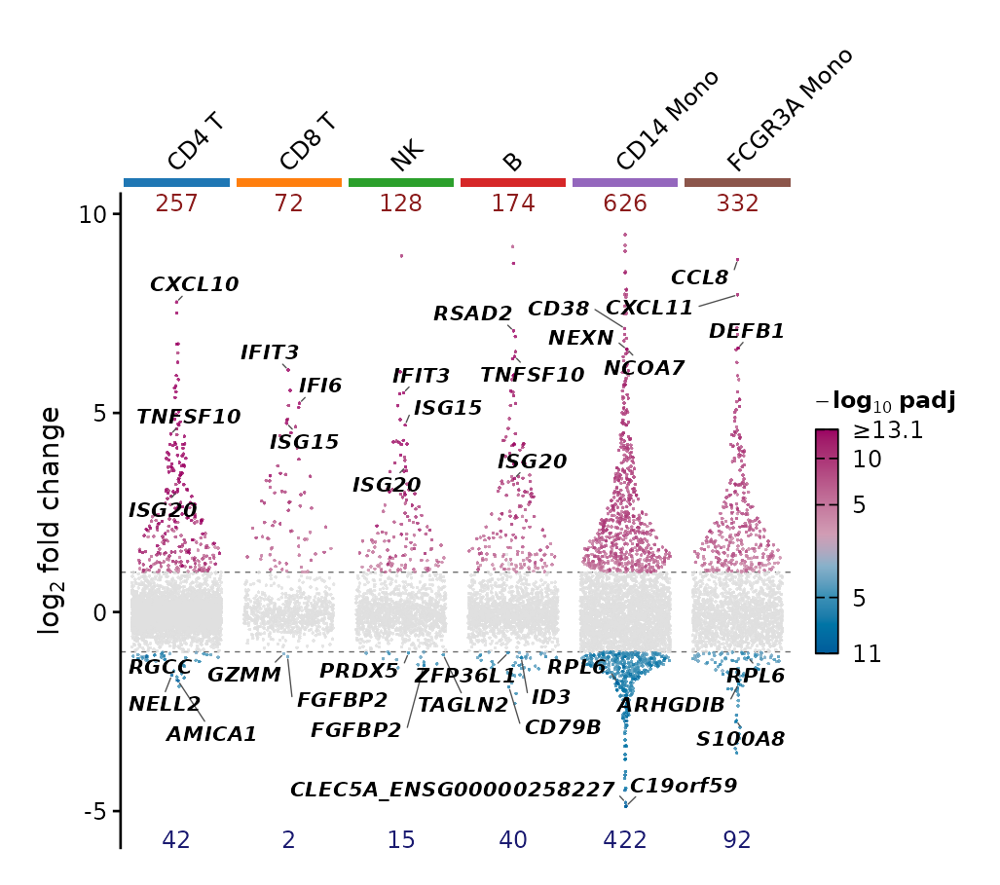

CD14 monocytes respond with the most genes; the top genes of every cell
type include interferon-stimulated genes. Colour is the −log10 adjusted
p-value (warm for up, cool for down), saturating at the 95th percentile
of the DE genes; each side of the colour bar ends at its own most
significant gene, so the direction with weaker p-values is not faded.

### Variants

- `groups`
- `flip`
- `layout`
- `color.by`
- `order`
- Cutoffs and `show.ns`

A second level: comparisons of a group are drawn together, the group
marked by a bar and its name at the bottom (`groups.side = "labels"`
puts it at the top, beyond the comparison names).

``` r

lineage <- c(
    "CD4 T" = "Lymphoid",
    "CD8 T" = "Lymphoid",
    "NK" = "Lymphoid",
    "B" = "Lymphoid",
    "CD14 Mono" = "Myeloid",
    "FCGR3A Mono" = "Myeloid"
)
plot_multi_volcano(de, groups = lineage)
```

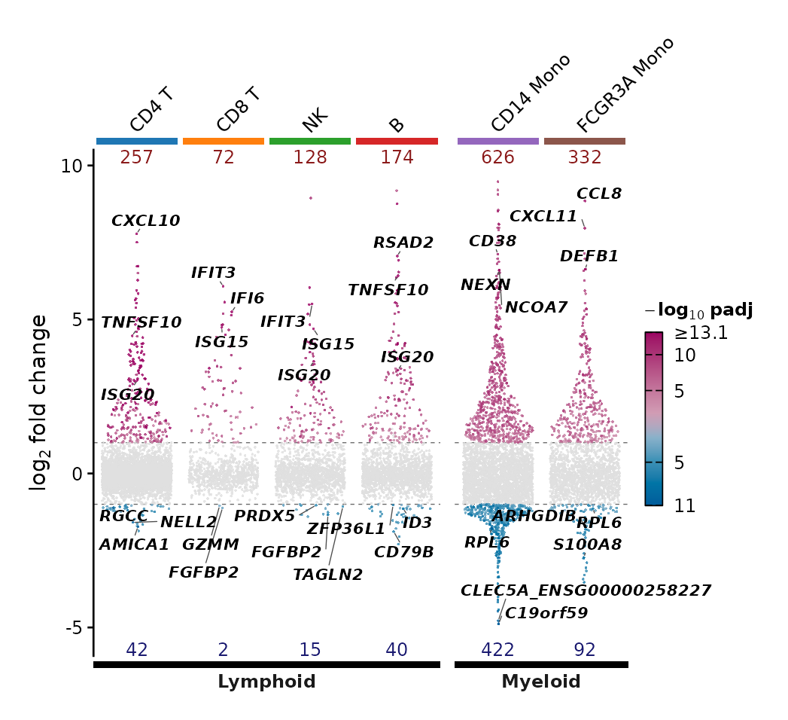

Comparisons as rows: down-regulated genes on the left, up-regulated on
the right, the comparison names and strips on the left.
`comparison.cols` takes a palette name, or colours named by comparison
(e.g. the cell type colours of the embedding plots):

``` r

plot_multi_volcano(
    de,
    flip = TRUE,
    groups = lineage,
    comparison.cols = "okabe-ito",
    label.n = 2
)
```

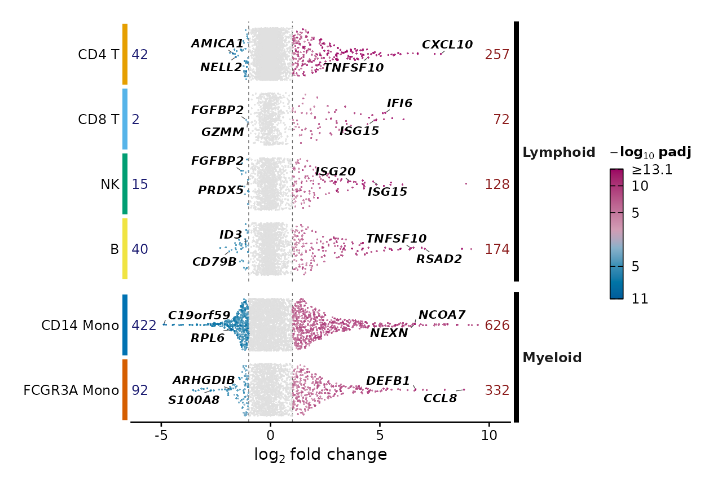

`"pvalue"` places genes across their column by −log10 adjusted p-value,
relative to the most significant gene on their side of 0 (each column is
a sideways volcano). It suits bulk results, where thousands of
non-significant genes would fill the column with grey in the default
layout; `"jitter"` spreads all genes uniformly.

``` r

plot_multi_volcano(de, layout = "pvalue")
```

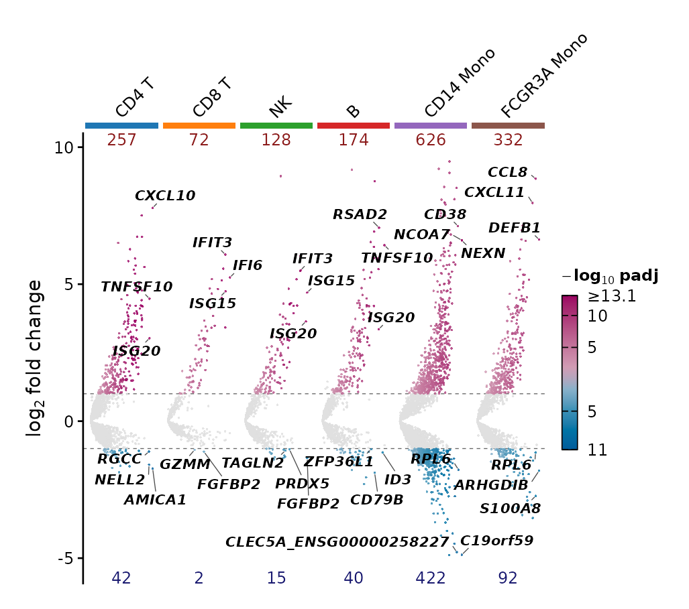

`"sharing"` colours genes by the number of comparisons they are DE in:
responses shared by all cell types versus specific to one. `"direction"`
uses one colour per direction.

``` r

plot_multi_volcano(de, color.by = "sharing", label = "none")
```

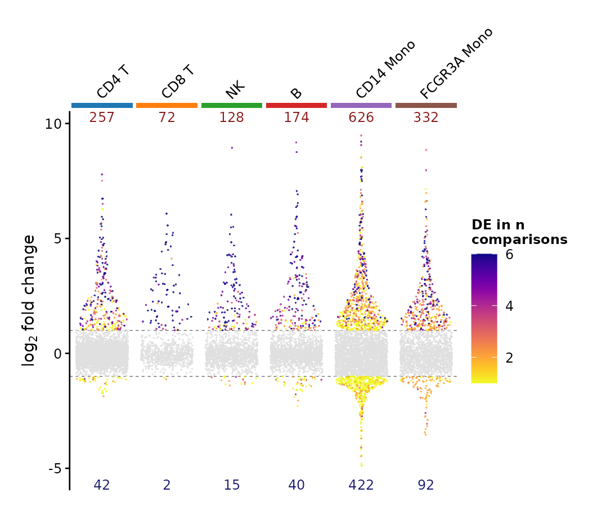

`"n_de"` puts the comparisons with the most DE genes first; `"cluster"`
groups comparisons with similar fold-change profiles.

``` r

plot_multi_volcano(de, order = "cluster", label.n = 2)
```

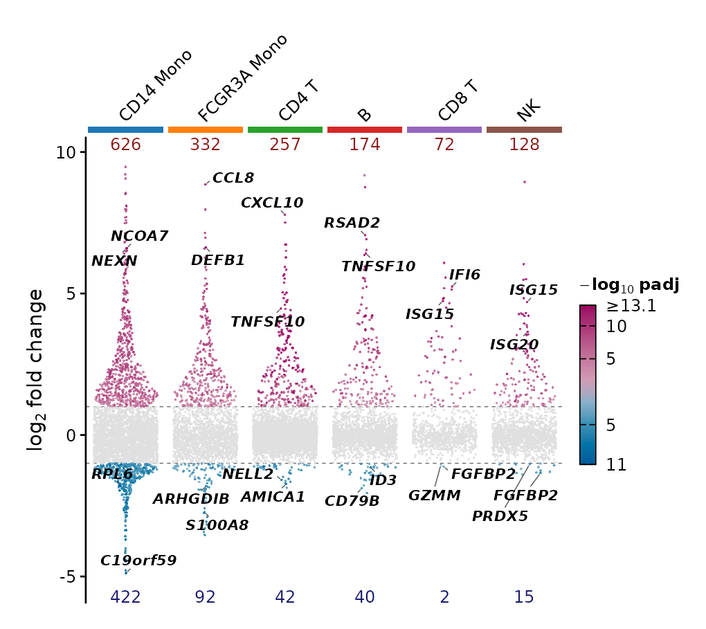

A lower `logfc.cutoff`, and only the DE genes (`show.ns = FALSE`):

``` r

plot_multi_volcano(
    de,
    show.ns = FALSE,
    logfc.cutoff = 0.5,
    label = "none"
)
```

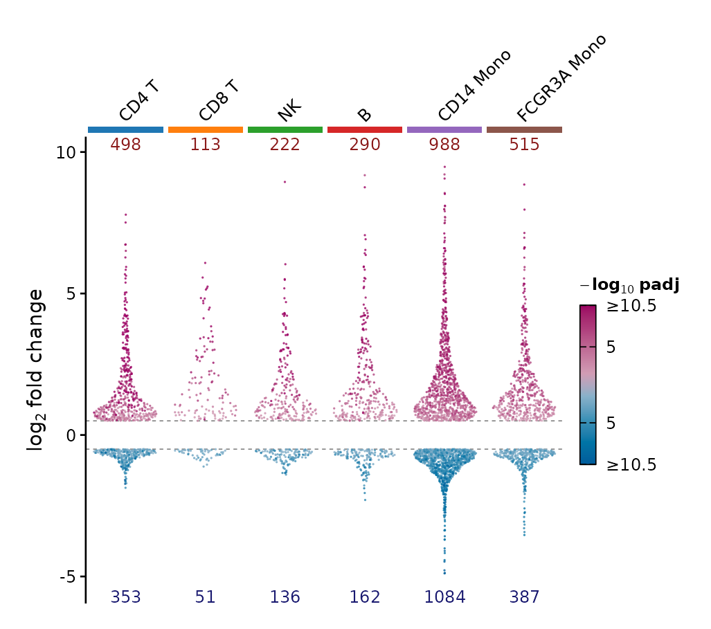

## DE dot plot

Chosen genes across comparisons: colour is the log2 fold change, size
the −log10 adjusted p-value, and non-significant results are faded. Each
comparison is marked by a coloured dot, as the groups of the single-cell
dot plot (`comparison.marker = "dot"`, `"strip"` or `"none"`). Without
`features`, the top `n` genes of each comparison:

``` r

plot_de_dots(de, n = 3)
```

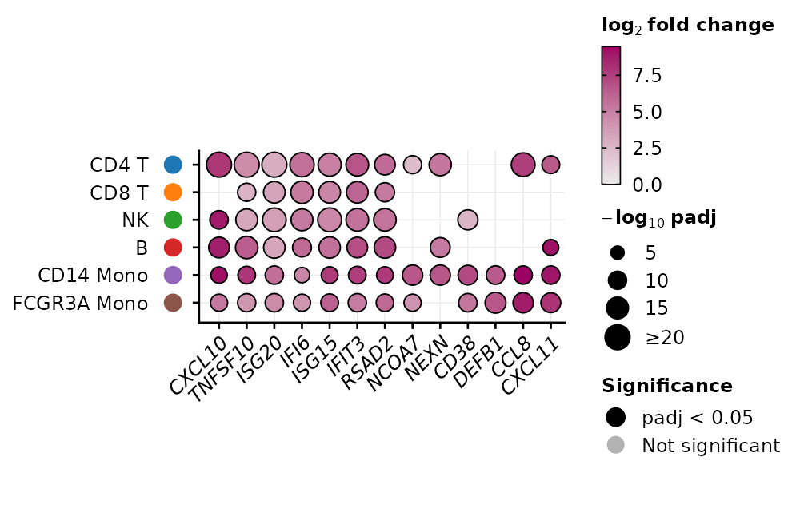

The colour scale is centred on 0 and runs from the most negative to the
most positive fold change of the significant dots, each side to its own
full colour; give `logfc.limits` to share one scale between figures.

### Variants

- Gene groups
- `significance`
- Clustering and `flip`
- `groups`

A named list of genes draws groups of columns, marked by bars on top
(coloured with `feature.group.cols`):

``` r

genes <- list(
    "Interferon-stimulated" = c("ISG15", "IFI6", "IFIT1", "IFIT3", "MX1", "OAS1"),
    "Chemokines" = c("CXCL10", "CCL2", "CCL8")
)
plot_de_dots(de, features = genes)
```

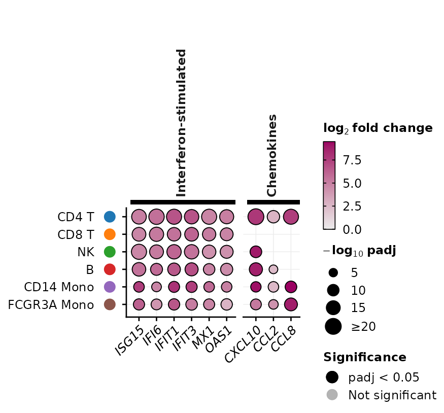

`"grey"` draws non-significant results grey; `"hide"` leaves them out:

``` r

plot_de_dots(de, features = genes, significance = "grey")
```

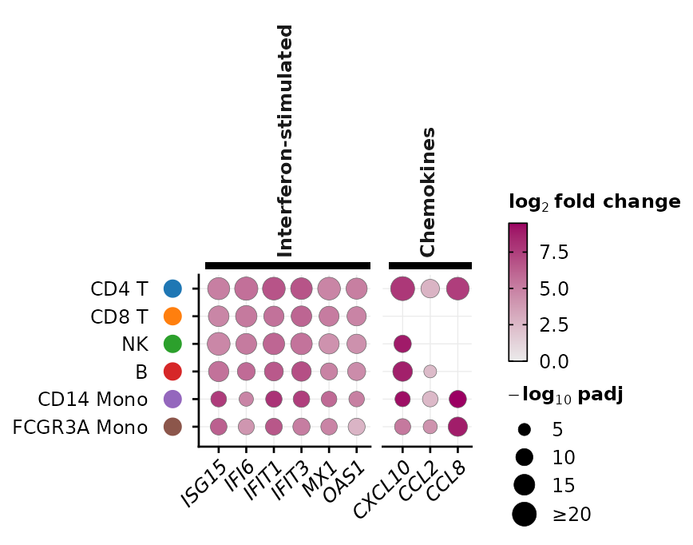

Genes and comparisons ordered by clustering of their fold changes; genes
as rows, comparisons as columns marked by colour strips:

``` r

plot_de_dots(
    de,
    n = 4,
    cluster.features = TRUE,
    cluster.comparisons = TRUE,
    flip = TRUE,
    comparison.marker = "strip"
)
```

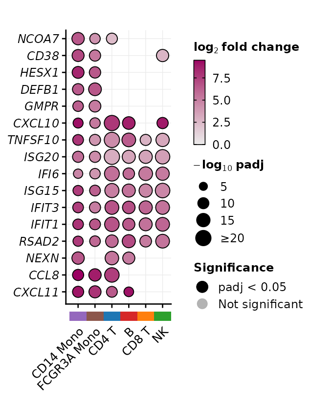

Comparisons in groups of rows, each marked by a bar and its name (here
in colour, beyond the comparison names):

``` r

plot_de_dots(
    de,
    features = genes,
    groups = lineage,
    groups.cols = c(Lymphoid = "#2C5DA8", Myeloid = "#B5338A"),
    groups.side = "labels"
)
```

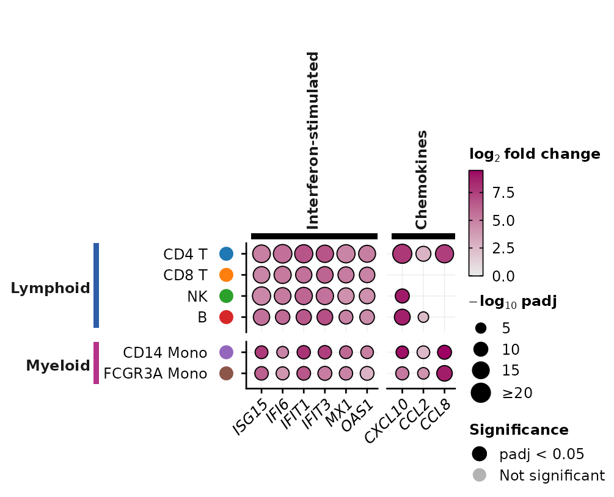

## Quadrant plot

The fold changes of two comparisons against each other, coloured by
where each gene is significant; counts of genes significant in both in
each quadrant, and the correlation of the fold changes above the panel.
Do monocytes and B cells respond to IFN-β with the same genes?

``` r

plot_fc_quadrant(
    de[["CD14 Mono"]],
    de[["B"]],
    name.x = "CD14 Mono",
    name.y = "B",
    label.n = 3
)
```

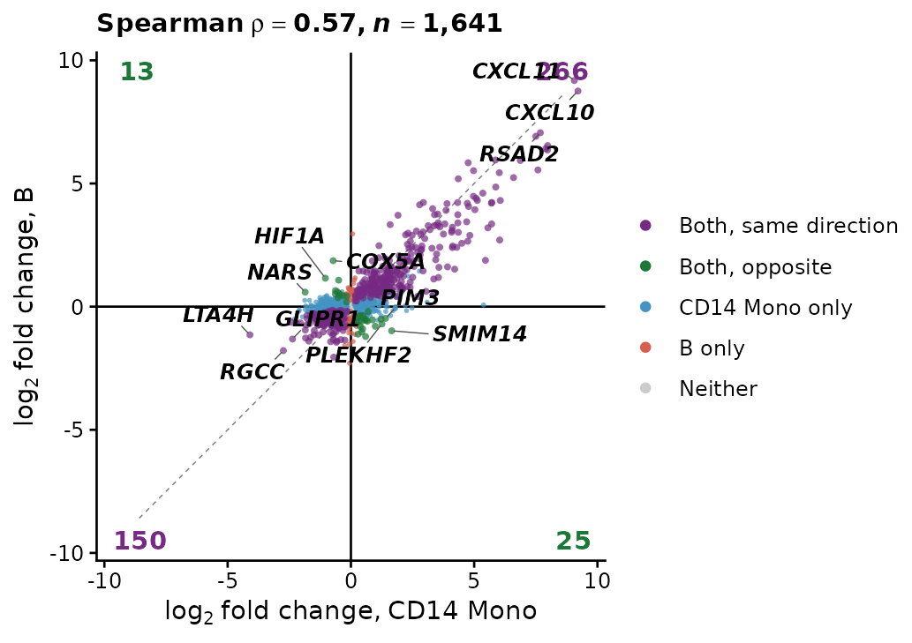

Most genes changed in both change in the same direction (concordant,
top-right and bottom-left), and B cells respond to fewer genes, more
weakly (the cloud lies below the diagonal on the right).

### Variants

- `trend`
- Two treatments
- `categories` and `cor.on`
- `label = "selected"`
- Peaks to genes: `map.y`

A least-squares line with its 95% confidence band, fitted on the genes
of the correlation (`cor.on`). Both fold changes are noisy estimates,
which biases a least-squares slope toward 0 (regression dilution): the
line shows the trend, but its slope is not the ratio of the two
responses.

``` r

plot_fc_quadrant(
    de[["CD14 Mono"]],
    de[["B"]],
    name.x = "CD14 Mono",
    name.y = "B",
    cor.on = "significant",
    trend = TRUE,
    label = "none"
)
```

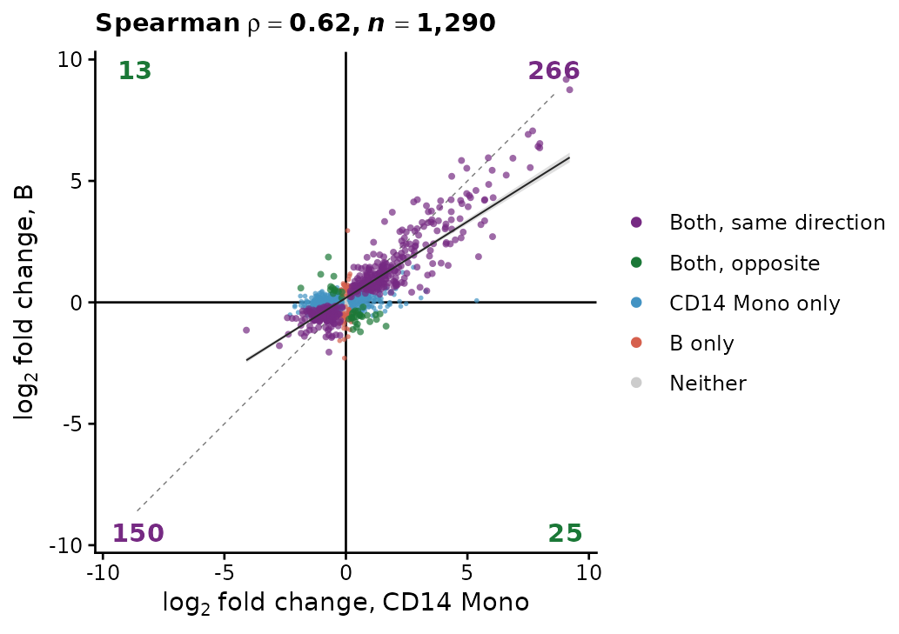

The comparisons can come from different experiments, tools or designs.
Here, macrophages ([Alasoo et
al. 2018](https://doi.org/10.1038/s41588-018-0046-7)) stimulated with
IFN-γ or infected with *Salmonella*, each against naive, paired by
donor:

``` r

mac <- docs_macrophage()
counts <- filter_low_expression_genes(mac$counts, min_group_size = 6)
y <- edgeR::normLibSizes(edgeR::DGEList(counts))
design <- model.matrix(~ donor + condition, data = mac$samples)
fit <- edgeR::glmQLFit(y, design)
test_ifng <- edgeR::glmQLFTest(fit, coef = "conditionIFNg")
test_sl1344 <- edgeR::glmQLFTest(fit, coef = "conditionSL1344")
de_ifng <- edgeR::topTags(test_ifng, n = Inf)
de_sl1344 <- edgeR::topTags(test_sl1344, n = Inf)
plot_fc_quadrant(
    de_ifng,
    de_sl1344,
    name.x = "IFN-γ",
    name.y = "Salmonella",
    logfc.cutoff = 1
)
```

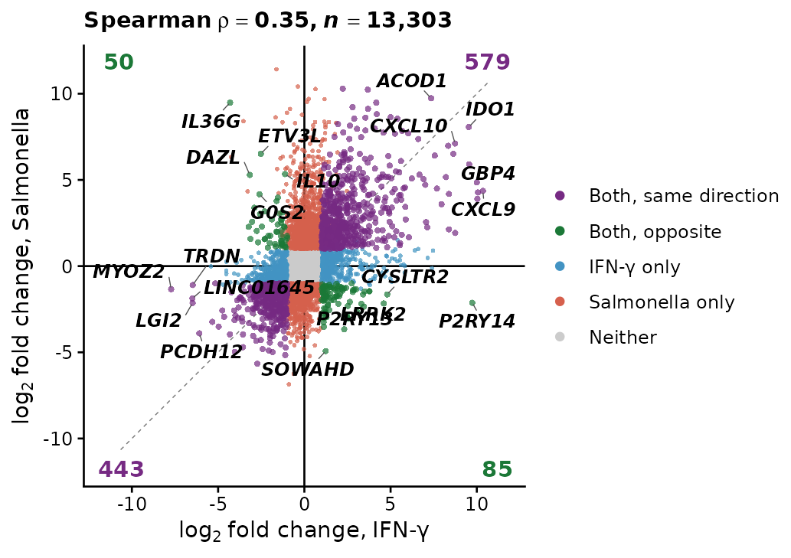

Colour only genes significant in both; correlation of the genes
significant in either comparison:

``` r

plot_fc_quadrant(
    de[["CD14 Mono"]],
    de[["CD4 T"]],
    name.x = "CD14 Mono",
    name.y = "CD4 T",
    categories = "both",
    cor.on = "significant",
    correlation = "pearson"
)
```

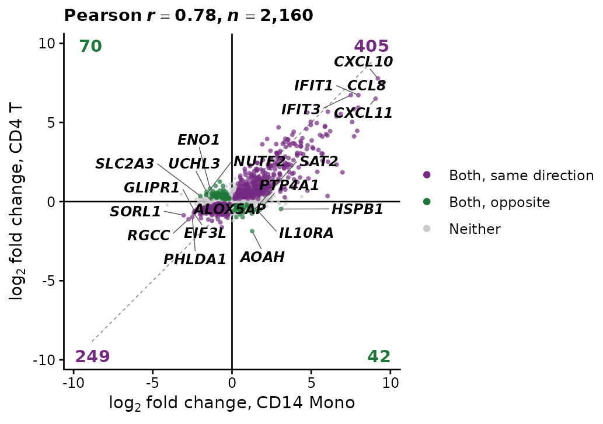

``` r

plot_fc_quadrant(
    de[["CD14 Mono"]],
    de[["B"]],
    name.x = "CD14 Mono",
    name.y = "B",
    label = "selected",
    label.features = c("ISG15", "CXCL10", "IFIT1", "MX1")
)
```

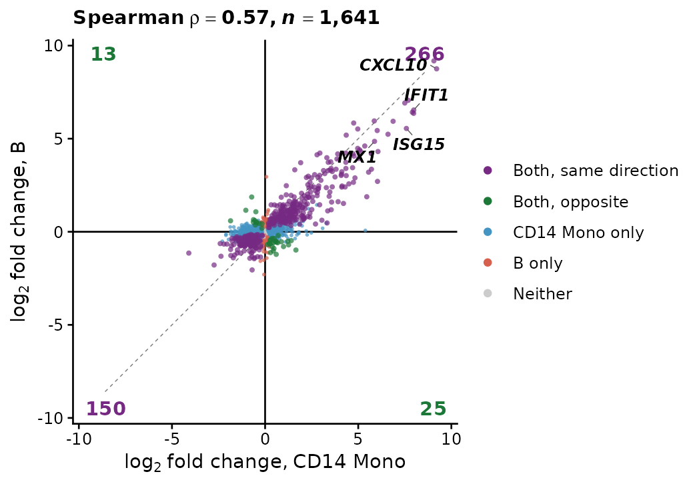

To compare RNA with chromatin (ATAC, ChIP, CUT&RUN), map the peaks of
`de.y` to genes with `map.y` (e.g. from a ChIPseeker annotation); with
several peaks per gene, the most significant one is used
(`map.summary`). The peak table below is **simulated** from the monocyte
RNA fold changes, only to show the input format:

``` r

rna <- de[["CD14 Mono"]]
set.seed(1)
genes_with_peaks <- sample(rownames(rna), 3000)
n_peaks <- sample(1:3, length(genes_with_peaks), replace = TRUE)
peak_gene <- rep(genes_with_peaks, n_peaks)
peak_logfc <- 0.5 * rna[peak_gene, "logFC"] + rnorm(length(peak_gene), sd = 0.6)
peaks <- data.frame(
    logFC = peak_logfc,
    row.names = paste0("peak_", seq_along(peak_gene))
)
peaks$PValue <- 2 * pnorm(-abs(peaks$logFC) / 0.4)
peaks$FDR <- p.adjust(peaks$PValue, "BH")
peak_to_gene <- data.frame(peak = rownames(peaks), gene = peak_gene)
head(peak_to_gene, 3)
#>     peak     gene
#> 1 peak_1 CYB561D2
#> 2 peak_2  PLEKHF2
#> 3 peak_3  PLEKHF2

plot_fc_quadrant(
    rna,
    peaks,
    name.x = "RNA",
    name.y = "ATAC (simulated)",
    map.y = peak_to_gene
)
```

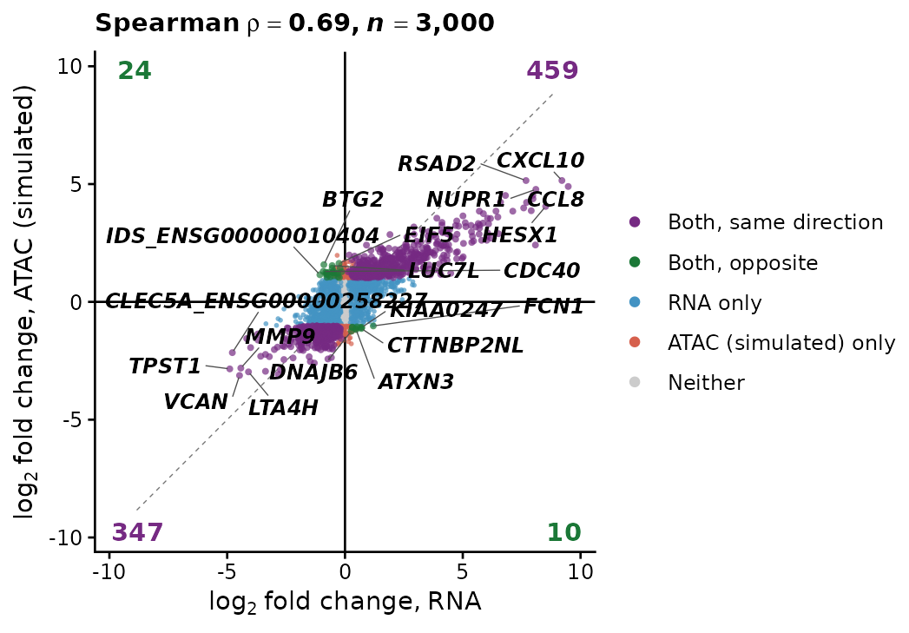
