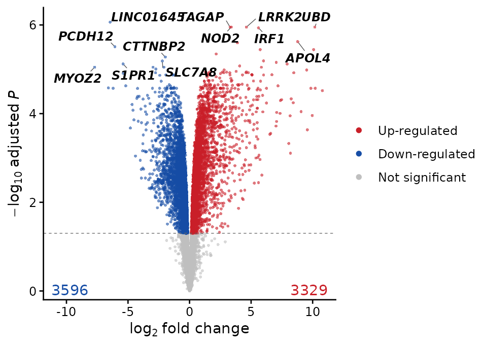
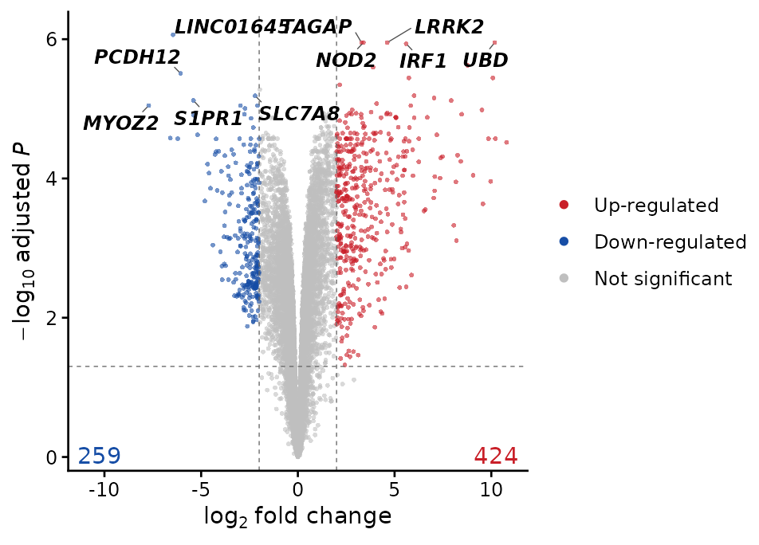
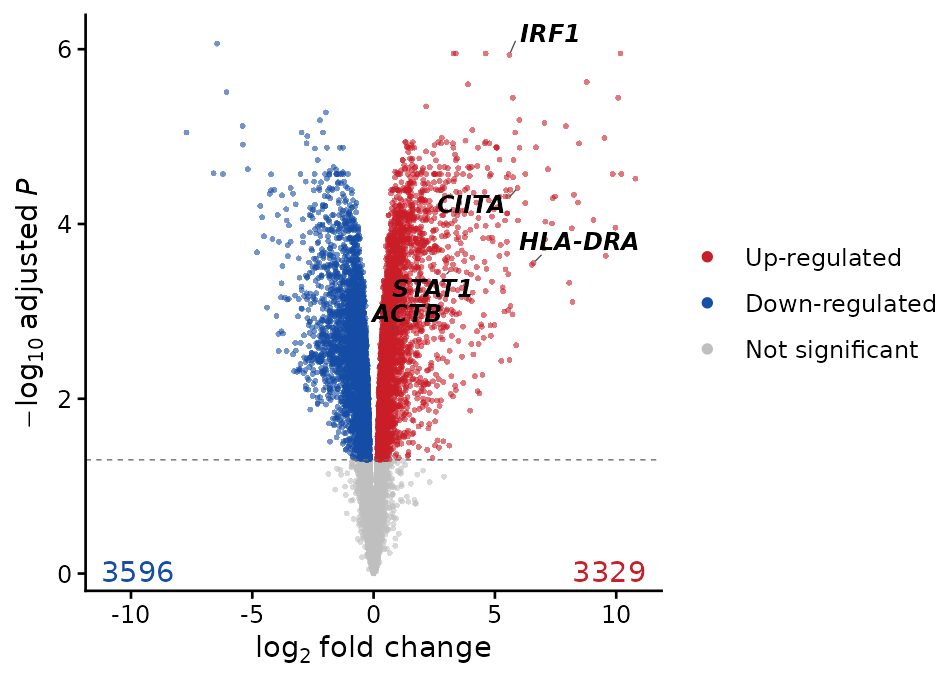
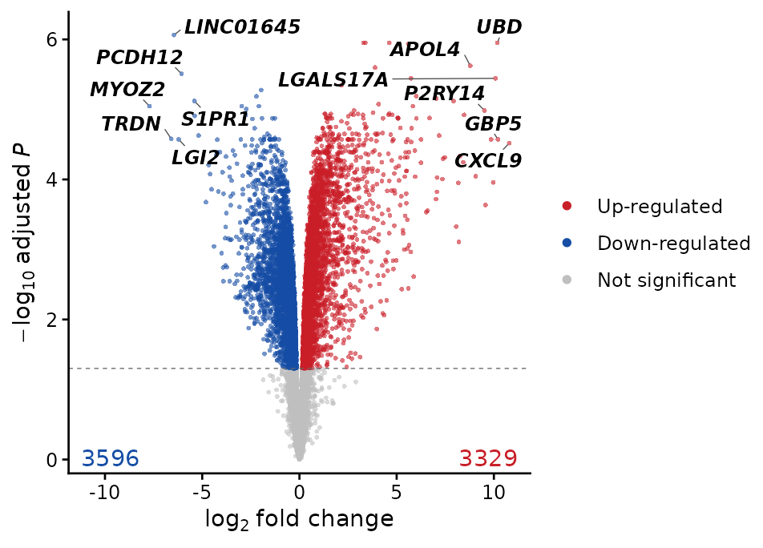
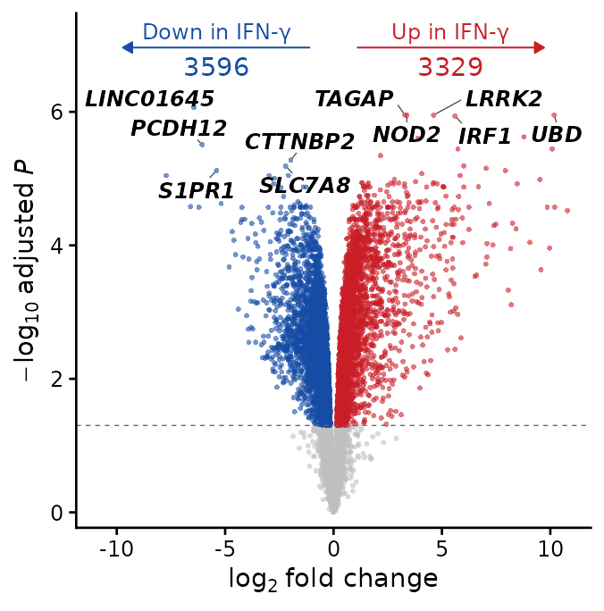
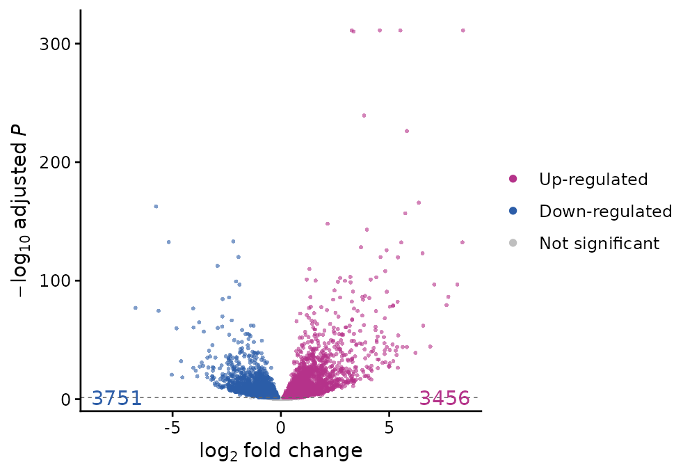
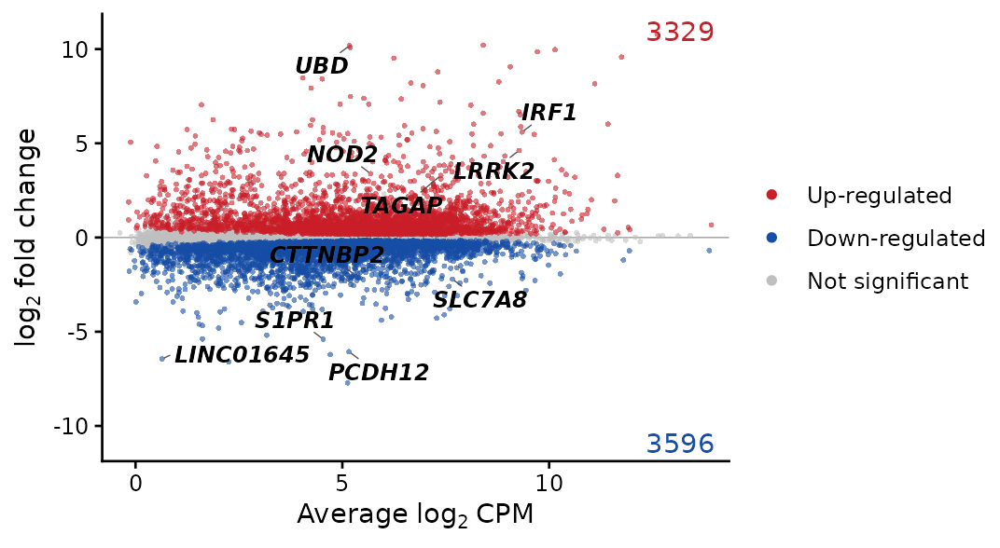
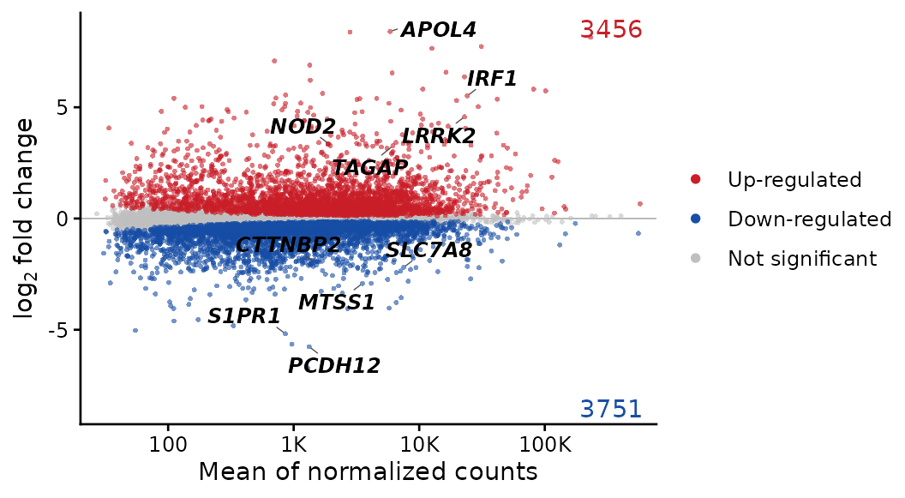
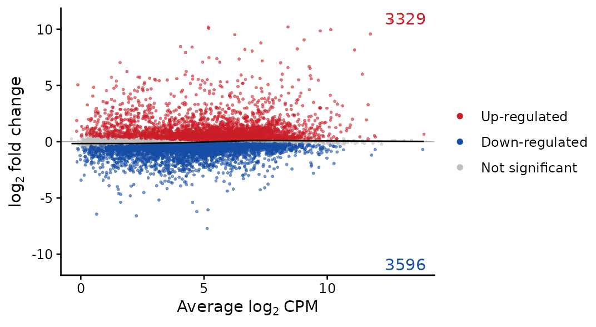

# Differential expression: one comparison

**Question:** which genes change between two conditions, by how much,
and how does that depend on their expression level?

| Function | Use |
|----|----|
| [`standardize_de()`](https://j-y26.github.io/bioToolkit/reference/standardize_de.md) | read any DE table into standard columns (used by every DE plot) |
| [`plot_volcano()`](https://j-y26.github.io/bioToolkit/reference/plot_volcano.md) | fold change against significance |
| [`plot_ma()`](https://j-y26.github.io/bioToolkit/reference/plot_ma.md) | fold change against mean expression |
| [`filter_de_genes()`](https://j-y26.github.io/bioToolkit/reference/filter_de_genes.md) | up- and down-regulated genes as two tables |
| [`rank_de_genes()`](https://j-y26.github.io/bioToolkit/reference/rank_de_genes.md), [`generate_de_rank_file()`](https://j-y26.github.io/bioToolkit/reference/generate_de_rank_file.md) | genes ranked by signed significance, for GSEA |

**Data:** macrophages of 6 donors, naive or stimulated with interferon-γ
(IFN-γ) ([Alasoo et
al. 2018](https://doi.org/10.1038/s41588-018-0046-7)). The same
comparison is tested with edgeR and with DESeq2, paired by donor (design
`~ donor + condition`), to show that the plots read either.

``` r

mac <- docs_macrophage()
keep <- mac$samples$condition %in% c("naive", "IFNg")
counts <- filter_low_expression_genes(mac$counts[, keep], min_group_size = 6)
samples <- droplevels(mac$samples[keep, ])

# edgeR quasi-likelihood test
design <- model.matrix(~ donor + condition, data = samples)
y <- edgeR::normLibSizes(edgeR::DGEList(counts))
fit <- edgeR::glmQLFit(y, design)
test <- edgeR::glmQLFTest(fit, coef = "conditionIFNg")
de_edger <- edgeR::topTags(test, n = Inf)

# DESeq2 Wald test, with shrunken fold changes
dds <- DESeq2::DESeqDataSetFromMatrix(
    counts,
    samples,
    design = ~ donor + condition
)
dds <- DESeq2::DESeq(dds, quiet = TRUE)
de_deseq <- DESeq2::results(dds, name = "condition_IFNg_vs_naive")
shrunk <- DESeq2::lfcShrink(
    dds,
    coef = "condition_IFNg_vs_naive",
    type = "normal",
    quiet = TRUE
)
de_deseq$log2FoldChange_shrunk <- shrunk$log2FoldChange
```

Fold-change shrinkage pulls the noisy fold changes of lowly expressed
genes towards 0. `type = "normal"` is built into DESeq2; its authors
recommend `type = "apeglm"` (package apeglm) or `"ashr"` when installed.

## Reading DE tables

Every DE plot of the package reads its input with
[`standardize_de()`](https://j-y26.github.io/bioToolkit/reference/standardize_de.md),
which recognises edgeR, DESeq2, limma and Seurat tables from their
column names and returns standard columns (`feature`, `logfc`, `pvalue`,
`padj`, `mean_expr`, then the table’s other columns):

``` r

head(standardize_de(de_edger), 3)
#> Detected edgeR results (logFC, PValue, FDR)
#>     feature     logfc       pvalue         padj mean_expr         F
#> 1 LINC01645 -6.445168 6.906463e-11 8.637223e-07 0.6412643  385.2972
#> 2     TAGAP  3.291148 2.793358e-10 1.119023e-06 7.3802895 1844.1143
#> 3      NOD2  3.386661 2.828302e-10 1.119023e-06 5.6846857 1838.0587
head(standardize_de(de_deseq, logfc.col = "log2FoldChange_shrunk"), 3)
#> Detected DESeq2 results (log2FoldChange, pvalue, padj)
#> 4 p-values of 0 replaced by 2.55999999769412e-315 (a tenth of the smallest non-zero value)
#> 4 adjusted p-values of 0 replaced by 6.41000000000069e-312 (a tenth of the smallest non-zero value)
#>   feature      logfc       pvalue         padj mean_expr log2FoldChange
#> 1    SPP1 -0.6664638 1.908492e-03 4.255992e-03  556815.1     -0.6902862
#> 2    ACTB  0.6581395 1.336112e-12 1.175064e-11  574651.6      0.6628589
#> 3     FTL  0.1154071 3.866035e-01 4.721085e-01  404628.0      0.1122727
#>        lfcSE       stat
#> 1 0.22237777 -3.1041149
#> 2 0.09348526  7.0905178
#> 3 0.12967607  0.8657933
```

| method | log fold change  | p-value   | adjusted p  | mean expression     |
|--------|------------------|-----------|-------------|---------------------|
| edgeR  | `logFC`          | `PValue`  | `FDR`       | `logCPM` (log2)     |
| DESeq2 | `log2FoldChange` | `pvalue`  | `padj`      | `baseMean` (linear) |
| limma  | `logFC`          | `P.Value` | `adj.P.Val` | `AveExpr` (log2)    |
| Seurat | `avg_log2FC`     | `p_val`   | `p_val_adj` | none                |

Any other table works with the columns given explicitly (`logfc.col`,
`p.col`, `padj.col`, `mean.col`, `feature.col`); the same arguments are
accepted by every DE plot. p-values of exactly 0 (underflow) are
replaced by a tenth of the smallest non-zero value, and NA p-values
(DESeq2’s independent filtering) are treated as not significant.

## Volcano plot

``` r

plot_volcano(de_edger, label.n = 6)
```



The y-axis is the −log10 **adjusted** p-value, the value that decides
significance, so the dashed line is the `padj.cutoff`. The `label.n`
most significant genes of each direction are labelled (10 by default),
among them interferon-γ targets such as *IRF1*, *APOL4* and *UBD*.

### Variants

- `logfc.cutoff`
- `label`
- `label.rank`
- `annotate.counts`
- `cols`

A minimum absolute fold change for significance, drawn as dashed lines:

``` r

plot_volcano(de_edger, logfc.cutoff = 2, label.n = 5)
```



`label = "selected"` labels only the genes given, significant or not;
`label = "top"` with `label.features` adds them to the top genes:

``` r

plot_volcano(
    de_edger,
    label = "selected",
    label.features = c("STAT1", "IRF1", "CIITA", "HLA-DRA", "ACTB")
)
```



The top genes ranked by `"padj"` (default), `"logfc"` or `"product"` of
both:

``` r

plot_volcano(de_edger, label.rank = "product", label.n = 6)
```



`"arrow"` names the directions with arrows and counts at the top (and
drops the legend); `"none"` hides the counts:

``` r

plot_volcano(
    de_edger,
    annotate.counts = "arrow",
    up.label = "Up in IFN-γ",
    down.label = "Down in IFN-γ",
    label.n = 5
)
```



Colours named `up`, `down`, `ns` (any of them):

``` r

plot_volcano(
    de_deseq,
    logfc.col = "log2FoldChange_shrunk",
    label = "none",
    cols = c(up = "#B5338A", down = "#2C5DA8")
)
```



## MA plot

Fold change against mean expression shows how both depend on the
expression level. edgeR’s `logCPM` is already log2 and drawn as it is:

``` r

plot_ma(de_edger, label.n = 5)
```



### Variants

- DESeq2, shrunken
- DESeq2, unshrunken
- `trend`

DESeq2’s `baseMean` is linear and drawn on a log10 axis (`mean.scale` is
taken from the method). With shrunken fold changes, the lowly expressed
genes on the left no longer fan out:

``` r

plot_ma(
    de_deseq,
    logfc.col = "log2FoldChange_shrunk",
    label.n = 5
)
```



The same genes without shrinkage, for comparison:

``` r

plot_ma(de_deseq, label = "none")
```


A robust trend line (lowess) through all genes: a trend away from 0
would point to an expression-dependent bias, such as a normalization
problem.

``` r

plot_ma(de_edger, trend = TRUE, label = "none")
```



## Gene lists

[`filter_de_genes()`](https://j-y26.github.io/bioToolkit/reference/filter_de_genes.md)
splits a DE table into up- and down-regulated genes (the rows of the
table, with all its columns), by adjusted p-value and absolute fold
change:

``` r

de_lists <- filter_de_genes(
    as.data.frame(de_edger),
    padj.cutoff = 0.05,
    logfc.cutoff = 1
)
#> Detected edgeR results (logFC, FDR)
vapply(de_lists, nrow, integer(1))
#>   up_reg down_reg 
#>     1061      936
head(rownames(de_lists$up_reg))
#> [1] "TAGAP" "NOD2"  "UBD"   "LRRK2" "IRF1"  "APOL4"
```

[`rank_de_genes()`](https://j-y26.github.io/bioToolkit/reference/rank_de_genes.md)
ranks all genes by the signed significance −log10(adjusted p) × sign(log
fold change), the “pi-value”: strongly up-regulated genes first,
strongly down-regulated last.
[`generate_de_rank_file()`](https://j-y26.github.io/bioToolkit/reference/generate_de_rank_file.md)
returns (and with `file`, writes) the two-column `.rnk` table of the
GSEA desktop application:

``` r

ranked <- rank_de_genes(as.data.frame(de_edger))
head(ranked[c("logFC", "FDR", "piValue", "rank")], 3)
#>           logFC          FDR  piValue rank
#> TAGAP  3.291148 1.119023e-06 5.951161    1
#> NOD2   3.386661 1.119023e-06 5.951161    2
#> UBD   10.178219 1.119023e-06 5.951161    3
# file = "ifng.rnk" writes it
rnk <- generate_de_rank_file(as.data.frame(de_edger))
head(rnk, 3)
#>   GeneName     rank
#> 1    TAGAP 5.951161
#> 2     NOD2 5.951161
#> 3      UBD 5.951161
```

For fgsea or clusterProfiler, the ranking is a named vector:
`setNames(rnk$rank, rnk$GeneName)` (see [Gene-set
enrichment](https://j-y26.github.io/bioToolkit/articles/enrichment.md)).
Many genes share the largest −log10 adjusted p-values; ranking by the
test statistic (edgeR `F` with the fold change sign, DESeq2 `stat`)
breaks such ties and is a common alternative.

These three functions take the same `method`, `logfc.col` and `padj.col`
as the plots (renamed in 0.10.0 from `de_method`, `log2fc_col`,
`pvalue_col`; the old names still work, with a deprecation warning).
