# Gene-set enrichment

**Question:** which pathways or gene programs are enriched among the
genes that change, in one comparison or across many?

| Function | Shows | Input |
|----|----|----|
| [`standardize_enrichment()`](https://j-y26.github.io/bioToolkit/reference/standardize_enrichment.md) | one table from any tool (used by every plot below) | fgsea, clusterProfiler, GSEA desktop |
| [`plot_enrichment_dots()`](https://j-y26.github.io/bioToolkit/reference/plot_enrichment_dots.md) | the top gene sets of one or a few results | ORA or GSEA |
| [`plot_enrichment_bars()`](https://j-y26.github.io/bioToolkit/reference/plot_enrichment_bars.md) | NES of the top up and down gene sets of one comparison | GSEA |
| [`plot_enrichment_grid()`](https://j-y26.github.io/bioToolkit/reference/plot_enrichment_grid.md) | gene sets × comparisons | ORA or GSEA |
| [`plot_gsea_rank()`](https://j-y26.github.io/bioToolkit/reference/plot_gsea_rank.md) | the running enrichment score of one gene set | GSEA with the ranked list |
| [`format_gene_sets()`](https://j-y26.github.io/bioToolkit/reference/format_gene_sets.md) | gene sets as a list, GMT or GeneSetCollection |  |

The two kinds of analysis answer different questions.
**Over-representation (ORA)** tests whether a gene list
(e.g. up-regulated genes) contains more genes of a set than expected;
the result depends on the cutoffs that made the list. **GSEA** ranks all
genes (e.g. by signed significance) and tests whether a set’s genes
gather at the top or bottom of the ranking; its normalized enrichment
score (NES) is signed.

**Data:** MSigDB Hallmark gene sets (msigdbr, human). GSEA: interferon-β
(IFN-β) vs control per cell type in the PBMCs of [Kang et
al. 2018](https://doi.org/10.1038/nbt.4042) (pseudobulk edgeR, see [DE:
many
comparisons](https://j-y26.github.io/bioToolkit/articles/de-multi.md)).
ORA: genes up- and down-regulated by IFN-γ in the macrophages of [Alasoo
et al. 2018](https://doi.org/10.1038/s41588-018-0046-7).

## Gene sets

``` r

# msigdbr::msigdbr(species = "Homo sapiens", collection = "H"), cached
hallmark <- docs_hallmark()
hallmark_list <- split(hallmark$gene_symbol, hallmark$gs_name)
length(hallmark_list)
#> [1] 50
```

[`format_gene_sets()`](https://j-y26.github.io/bioToolkit/reference/format_gene_sets.md)
converts between a named list (the input of fgsea and
[`Seurat::AddModuleScore()`](https://satijalab.org/seurat/reference/AddModuleScore.html)),
a GMT file and a GSEABase `GeneSetCollection`:

``` r

gmt_file <- tempfile(fileext = ".gmt")
# Write a GMT file, then read it back as a list
format_gene_sets(hallmark_list, to = "gmt", file = gmt_file)
substr(readLines(gmt_file, n = 2), 1, 70)
#> [1] "HALLMARK_ADIPOGENESIS\t\tABCA1\tABCB8\tACAA2\tACADL\tACADM\tACADS\tACLY\tACO2\tA"
#> [2] "HALLMARK_ALLOGRAFT_REJECTION\t\tAARS1\tABCE1\tABI1\tACHE\tACVR2A\tAKT1\tAPBB1\t"
sets <- format_gene_sets(gmt_file, to = "list")
identical(sets, lapply(hallmark_list, unique))
#> [1] TRUE
```

## Running the analyses

GSEA with fgsea, per cell type. The ranking metric is the signed −log10
p-value of each gene (adjusted p-values have many ties):

``` r

de <- docs_kang_de()
signed_p <- function(t) {
    stats <- -log10(t$PValue) * sign(t$logFC)
    sort(setNames(stats, rownames(t)), decreasing = TRUE)
}
ranks <- lapply(de, signed_p)
set.seed(1)
# eps = 0: estimate very small p-values exactly (fgsea's recommendation)
gsea <- lapply(ranks, function(r) {
    fgsea::fgsea(hallmark_list, r, minSize = 15, maxSize = 500, eps = 0)
})
```

ORA with clusterProfiler, for the genes up- and down-regulated by IFN-γ
in macrophages (edgeR, paired by donor), against all tested genes as the
universe:

``` r

mac <- docs_macrophage()
keep <- mac$samples$condition %in% c("naive", "IFNg")
samples <- droplevels(mac$samples[keep, ])
counts <- filter_low_expression_genes(mac$counts[, keep], 6)
y <- edgeR::normLibSizes(edgeR::DGEList(counts))
design <- model.matrix(~ donor + condition, data = samples)
fit <- edgeR::glmQLFit(y, design)
test <- edgeR::glmQLFTest(fit, coef = "conditionIFNg")
de_ifng <- as.data.frame(edgeR::topTags(test, n = Inf))
lists <- filter_de_genes(de_ifng, logfc.cutoff = 1)

term2gene <- hallmark[c("gs_name", "gene_symbol")]
ora <- lapply(lists, function(d) {
    clusterProfiler::enricher(
        rownames(d),
        TERM2GENE = term2gene,
        universe = rownames(de_ifng)
    )
})
names(ora) <- c("Up in IFN-γ", "Down in IFN-γ")
```

## Reading results

Every plot reads its input with
[`standardize_enrichment()`](https://j-y26.github.io/bioToolkit/reference/standardize_enrichment.md),
which recognises fgsea, clusterProfiler (GSEA and ORA) and GSEA desktop
tables, and makes MSigDB names readable (`clean.terms`:
“HALLMARK_INTERFERON_ALPHA_RESPONSE” becomes “Interferon alpha
response”; the original is kept in `term_id`):

``` r

std <- standardize_enrichment(gsea)
top_rows <- std[order(std$padj), c("term", "comparison", "nes", "padj", "size")]
head(top_rows, 4)
#>                          term comparison      nes         padj size
#> 148 Interferon gamma response  CD14 Mono 2.959178 1.240949e-37  140
#> 23  Interferon alpha response      CD4 T 2.322855 8.082227e-33   72
#> 24  Interferon gamma response      CD4 T 2.294325 8.082227e-33  120
#> 147 Interferon alpha response  CD14 Mono 2.961099 2.563371e-30   77
```

A named list gives one comparison per element; a clusterProfiler result
object can be passed as it is.

## Top gene sets: dot plot

The most significant gene sets of a result. For ORA, the x-axis is the
gene ratio (genes of the set in the list / genes in the list), the size
the number of genes and the colour the −log10 adjusted p-value. One
result is one panel, with its colour bar and size legend side by side:

``` r

plot_enrichment_dots(ora[["Up in IFN-γ"]], n = 8)
```

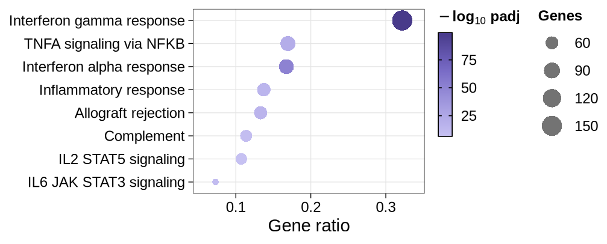

A GSEA result alone, on the NES (sizes: leading-edge genes):

``` r

plot_enrichment_dots(gsea[["CD14 Mono"]], x = "nes", n = 8)
```

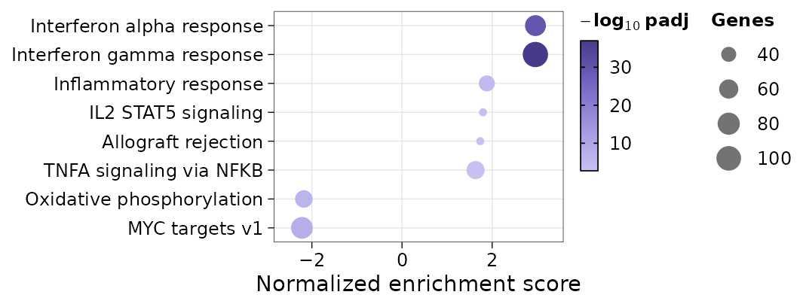

A named list gives one panel per result, each in its own palette. All
strips have the same thickness, their names centred, and the legends sit
in two columns: the colour bars of the panels (top panel first), then
the size legend (one, since the panels share their limits):

``` r

plot_enrichment_dots(ora, n = 8)
```

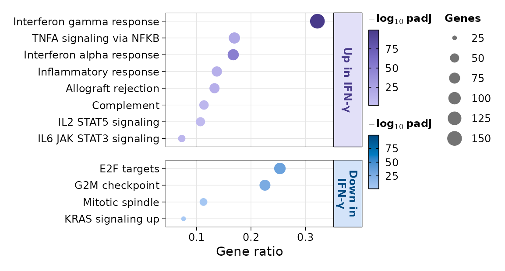

### Variants

- `x = "nes"`
- `order.by` and `term.replace`
- `shared.scale`
- `legend.layout = "stacked"`

GSEA results on the NES; several cell types side by side (`nrow = 1`):

``` r

plot_enrichment_dots(
    gsea[c("CD14 Mono", "B")],
    x = "nes",
    n = 6,
    nrow = 1
)
```

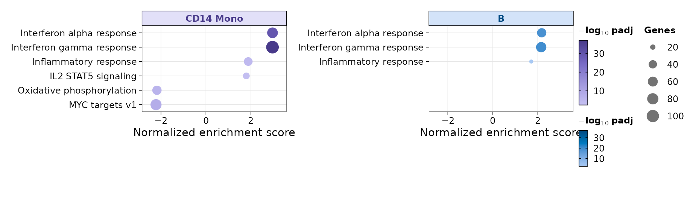

Ordered by significance, with shortened names:

``` r

plot_enrichment_dots(
    ora,
    n = 6,
    order.by = "padj",
    term.replace = c("Interferon" = "IFN", " response" = "")
)
```

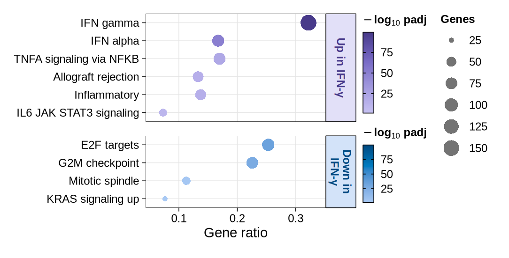

`shared.scale = FALSE` gives each panel its own colour and size range,
when the results differ in strength; each panel then has its own size
legend:

``` r

plot_enrichment_dots(ora, n = 6, shared.scale = FALSE, cols = "seq-blue")
```

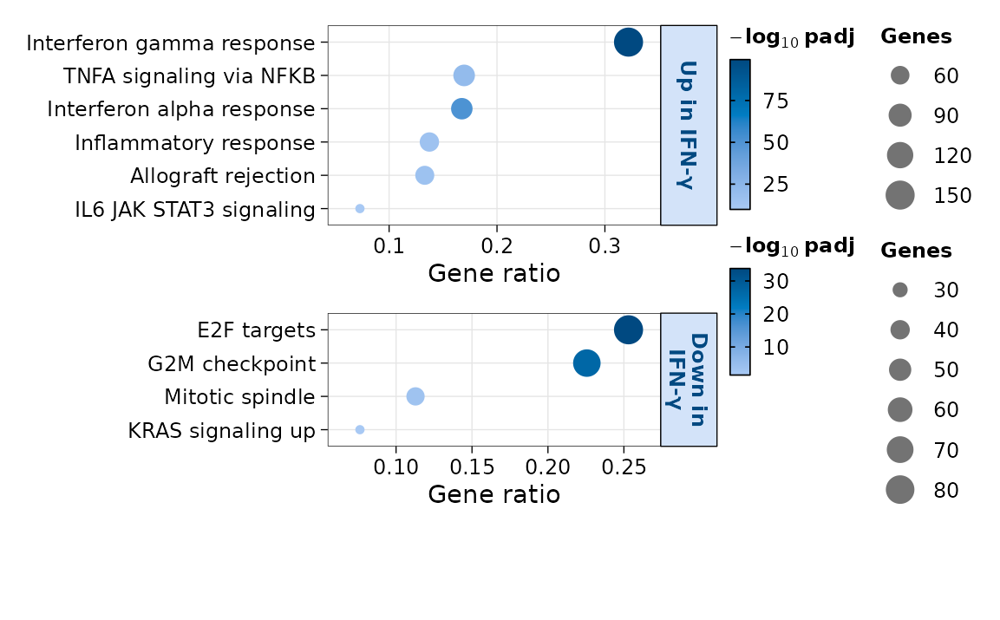

All legends in one column, each panel’s colour bar and size legend in
turn:

``` r

plot_enrichment_dots(ora, n = 6, legend.layout = "stacked")
```

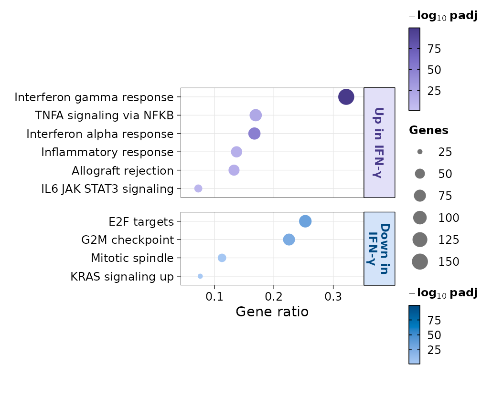

## One comparison: NES bars

The top gene sets with positive and negative NES of one comparison;
names sit on the opposite side of 0 from their bars:

``` r

plot_enrichment_bars(gsea, comparison = "CD14 Mono", n.up = 6, n.down = 6)
```


### Variants

- `fill = "padj"`
- `show.ns`

``` r

plot_enrichment_bars(
    gsea,
    comparison = "CD14 Mono",
    n.up = 6,
    n.down = 6,
    fill = "padj"
)
```

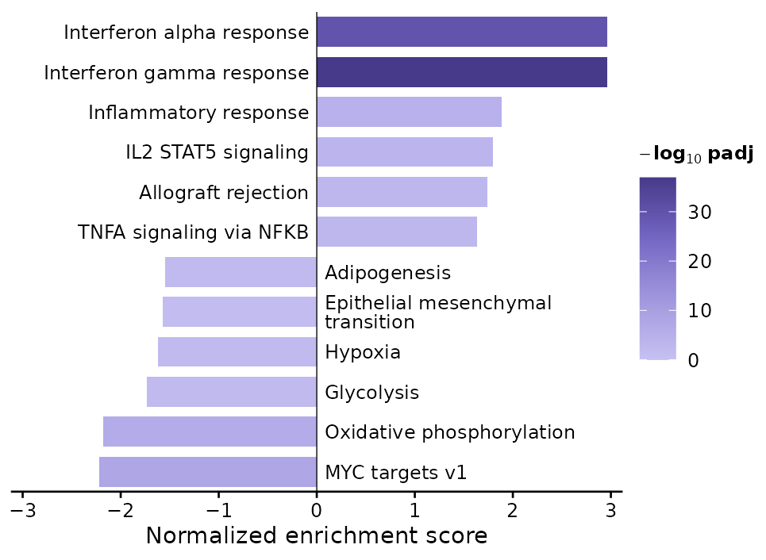

Non-significant gene sets fill the bars when there are fewer significant
ones, faded:

``` r

plot_enrichment_bars(
    gsea,
    comparison = "B",
    n.up = 5,
    n.down = 5,
    show.ns = TRUE
)
```

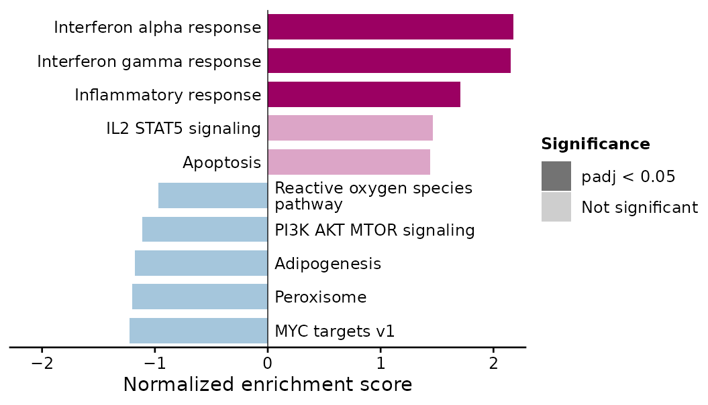

## Many comparisons: grid

Gene sets × comparisons: colour is the NES (centred on 0, each side to
its own extreme), size the −log10 adjusted p-value, non-significant
results faded; by default the top `n` sets of each comparison,
clustered:

``` r

plot_enrichment_grid(gsea, n = 4)
```

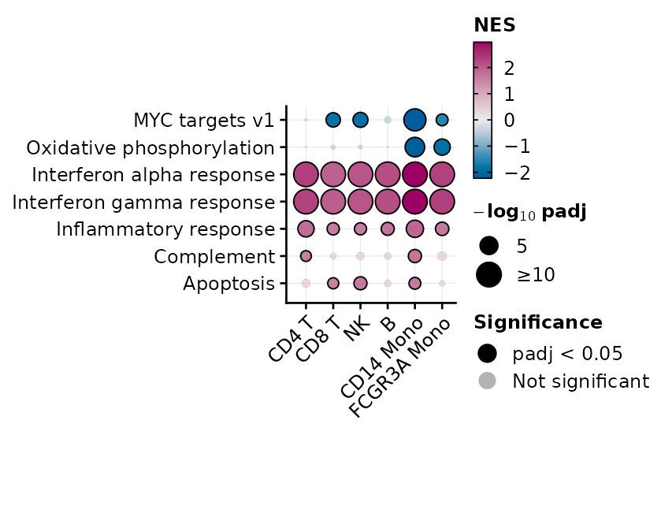

### Variants

- `terms`
- ORA
- `significance` and `flip`

Chosen gene sets, in groups of rows marked by bars:

``` r

chosen <- list(
    Interferon = c("Interferon alpha response", "Interferon gamma response"),
    Inflammation = c("Inflammatory response", "TNFA signaling via NFKB", "IL6 JAK STAT3 signaling"),
    Proliferation = c("E2F targets", "G2M checkpoint", "MYC targets v1")
)
plot_enrichment_grid(gsea, terms = chosen)
```

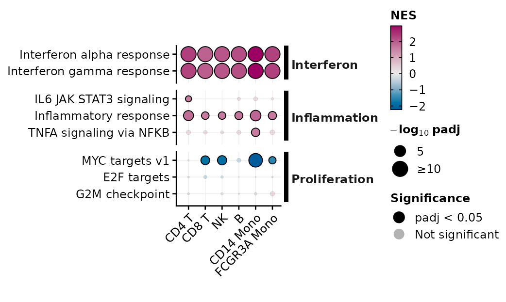

Over-representation results are coloured by significance and sized by
the number of genes:

``` r

plot_enrichment_grid(ora, n = 6)
```

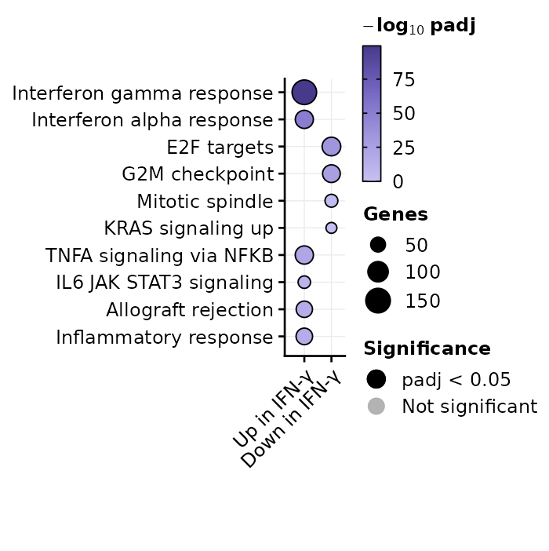

``` r

plot_enrichment_grid(gsea, n = 3, significance = "hide", flip = TRUE)
```

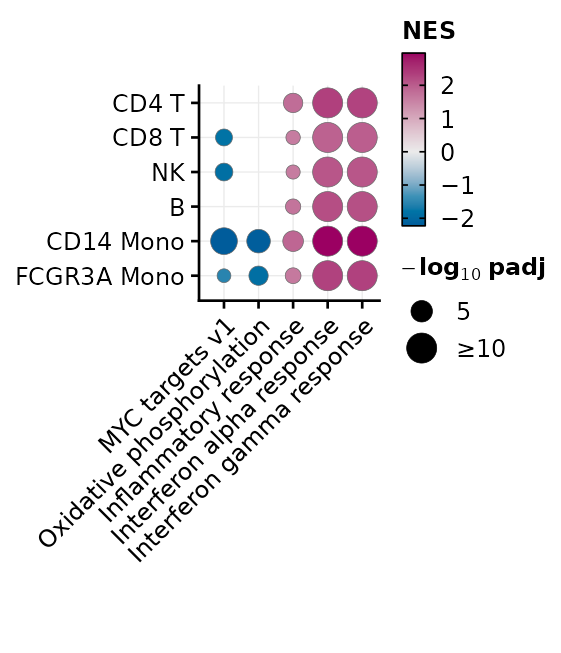

## One gene set: running score

[`plot_gsea_rank()`](https://j-y26.github.io/bioToolkit/reference/plot_gsea_rank.md)
draws the running enrichment score of a gene set along the ranked list,
the positions of its genes, and the ranking metric. From fgsea results,
give the ranked list (`stats`) and the gene sets. The first five genes
of the leading edge (the set’s genes before the peak of the score) are
named, with an arrow to their ticks:

``` r

plot_gsea_rank(
    gsea,
    "HALLMARK_INTERFERON_ALPHA_RESPONSE",
    comparison = "CD14 Mono",
    stats = ranks[["CD14 Mono"]],
    gene.sets = hallmark_list,
    metric.title = "Signed\n-log10 p"
)
```

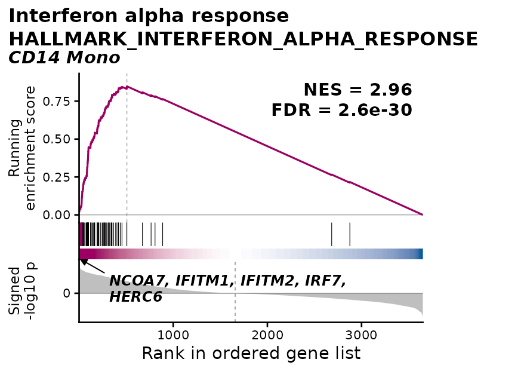

The band under the gene positions is the ranking metric along the list,
as in the GSEA desktop plot: magenta where genes rank up (metric above
0), white around 0, blue where they rank down. It is the same for every
gene set of a comparison and shows where the list turns from up- to
down-ranked genes (the dashed line in the metric panel). It is not the
band of
[`enrichplot::gseaplot2()`](https://rdrr.io/pkg/enrichplot/man/gseaplot2.html),
which colours eight stretches of the list holding equal shares of the
set’s genes and encodes no value at the rank where it is drawn.

### Variants

- Negative score
- Chosen genes
- clusterProfiler

The gene set with the most significant negative NES in CD14 monocytes;
its leading edge is at the end of the list, named from the most
down-ranked gene:

``` r

mono <- gsea[["CD14 Mono"]]
negative_set <- mono$pathway[which.min(ifelse(mono$NES < 0, mono$padj, Inf))]
plot_gsea_rank(
    gsea,
    negative_set,
    comparison = "CD14 Mono",
    stats = ranks[["CD14 Mono"]],
    gene.sets = hallmark_list,
    metric.title = "Signed\n-log10 p"
)
```

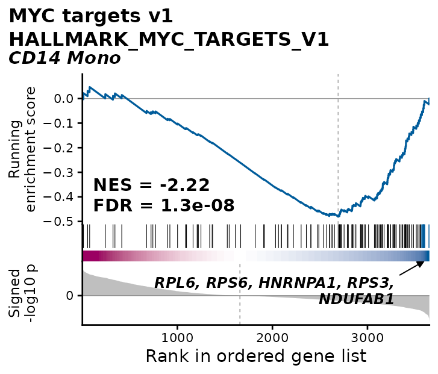

`label = "selected"` names the genes given (`label.features`); `"none"`
names none. `band = "none"` leaves the band out:

``` r

plot_gsea_rank(
    gsea,
    "HALLMARK_INTERFERON_ALPHA_RESPONSE",
    comparison = "CD14 Mono",
    stats = ranks[["CD14 Mono"]],
    gene.sets = hallmark_list,
    label = "selected",
    label.features = c("ISG15", "IFIT1", "MX1"),
    band = "none"
)
#> Warning: `label.features` not in the gene set: IFIT1
```

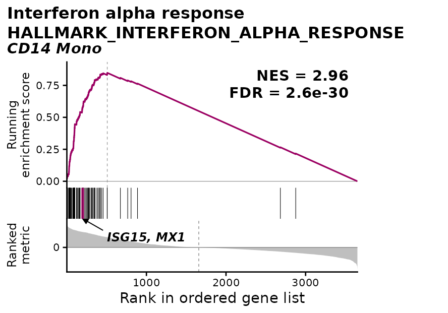

A clusterProfiler `GSEA()` result holds the ranked list and the gene
sets, so it is plotted directly; a gene set can also be named by its
cleaned name:

``` r

cp <- clusterProfiler::GSEA(
    ranks[["B"]],
    TERM2GENE = term2gene,
    pvalueCutoff = 1,
    eps = 0,
    seed = TRUE,
    verbose = FALSE
)
plot_gsea_rank(
    cp,
    "Interferon gamma response",
    comparison = "B",
    metric.title = "Signed\n-log10 p"
)
```

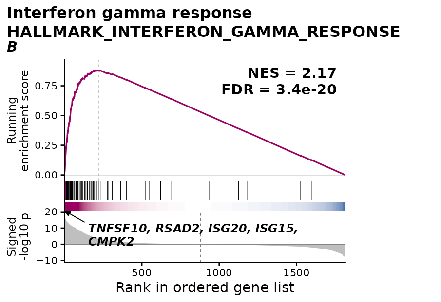
