# Figure essentials and colours

Every plot of the package follows the same rules, so a figure made from
one function matches the others:

|  |  |
|----|----|
| **Theme** | [`theme_bioToolkit()`](https://j-y26.github.io/bioToolkit/reference/theme_bioToolkit.md): 11 / 9 / 12 pt text, 1 pt axes, bold legend titles, transparent background |
| **Size** | panels have a fixed size in inches (`panel.width`, `cell.width`, …), whatever the legend or number of groups |
| **Saving** | [`save_plot()`](https://j-y26.github.io/bioToolkit/reference/save_plot.md) sizes the file to fit the plot; PDF (vector) or PNG at 1000 dpi |
| **Colours** | one `cols` argument: a palette name, or colours named by group / from low to high |
| **Gene names** | in italics, symbols used as given (check the case for the organism) |
| **Data** | [`export_source_data()`](https://j-y26.github.io/bioToolkit/reference/export_source_data.md) writes the table behind any plot |

The examples use PBMCs from [Kang et
al. 2018](https://doi.org/10.1038/nbt.4042) (control or interferon-β, 8
donors; 8,000 cells), loaded by the guides’ data helper; any Seurat
object works the same way.

``` r

pbmc <- docs_kang()
p <- DimPlot_bioToolkit(pbmc, group.by = "cell_type", label = TRUE)
p
```

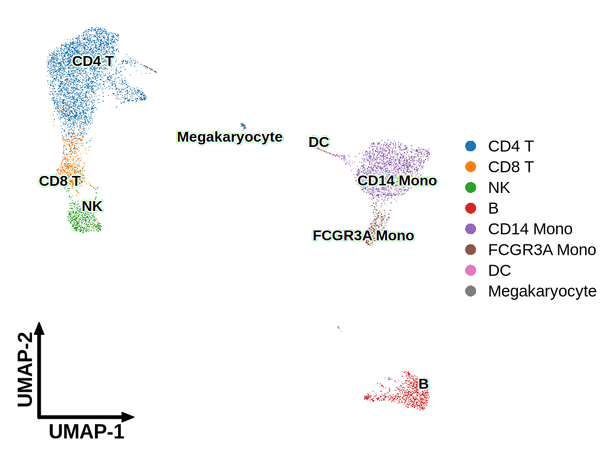

## Theme

[`theme_bioToolkit()`](https://j-y26.github.io/bioToolkit/reference/theme_bioToolkit.md)
is used by all plots of the package and can be added to any ggplot. Its
`type` sets the layout. A small simulated table for the examples:

``` r

set.seed(1)
toy <- data.frame(
    x = rnorm(60),
    y = rnorm(60),
    group = rep(c("A", "B", "C"), 20)
)
```

### Layouts

- “axis”
- “grid”
- “embedding”

Axis lines and ticks, no grid: scatter, volcano, MA, bar and PCA plots.

``` r

ggplot(toy, aes(x, y, colour = group)) +
    geom_point() +
    theme_bioToolkit("axis") +
    panel_size_theme(2)
```

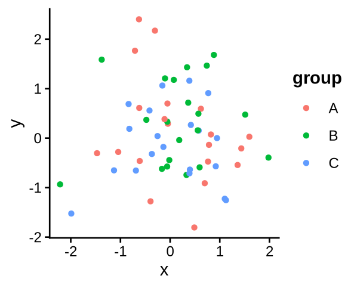

Light grid, rotated x labels, no axis titles: dot plots and heatmaps,
whose rows and columns are categories.

``` r

ggplot(toy, aes(group, cut(x, 4), colour = y)) +
    geom_point(size = 3) +
    theme_bioToolkit("grid") +
    panel_size_theme(1.2, 1.6)
```

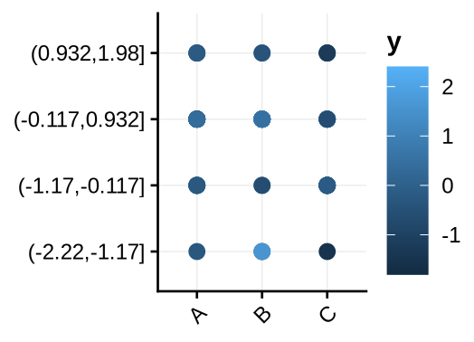

No axes, room for the dimension arrows: UMAP and t-SNE.

``` r

ggplot(toy, aes(x, y, colour = group)) +
    geom_point() +
    theme_bioToolkit("embedding") +
    panel_size_theme(2)
```

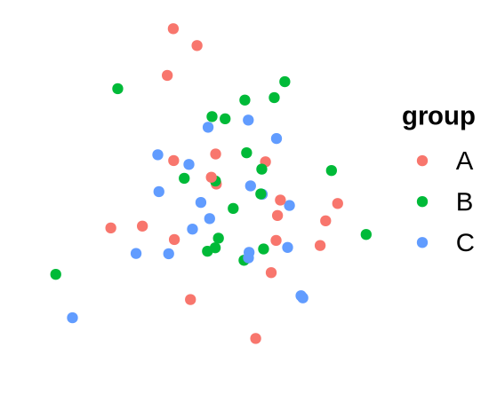

## Fixed panel sizes

A panel has the same size in every figure, whatever the length of the
labels or the size of the legend, so panels line up when figures are
assembled. The package’s plots take the size in inches, in one of two
ways:

| Argument | Plots | What it sets |
|----|----|----|
| `panel.width`, `panel.height` | continuous axes: embeddings, volcano, MA, PCA, scatter | the whole panel. Scatter-type panels are square by default, so `panel.width` alone resizes them |
| `cell.width`, `cell.height` | categories: dot plots, heatmaps, violins, multi-volcano | **one** column or row (one gene, one group). The panel is the number of columns × `cell.width` |

With cell sizes, a dot plot of 8 genes is twice as wide as one of 4, but
a dot, a gene name and the gap between genes are the same size in both,
so several dot plots in a figure match each other.

### Sizes

- `panel.width`
- `cell.width`: 4 genes
- `cell.width`: 8 genes
- Larger cells
- Any ggplot

``` r

DimPlot_bioToolkit(pbmc, group.by = "condition", panel.width = 2.5)
```

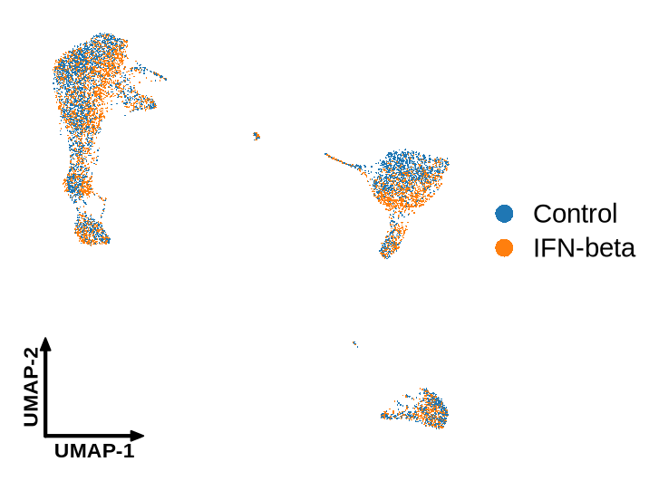

``` r

DotPlot_bioToolkit(
    pbmc,
    features = c("CD3E", "MS4A1", "CD14", "FCGR3A"),
    group.by = "cell_type"
)
```

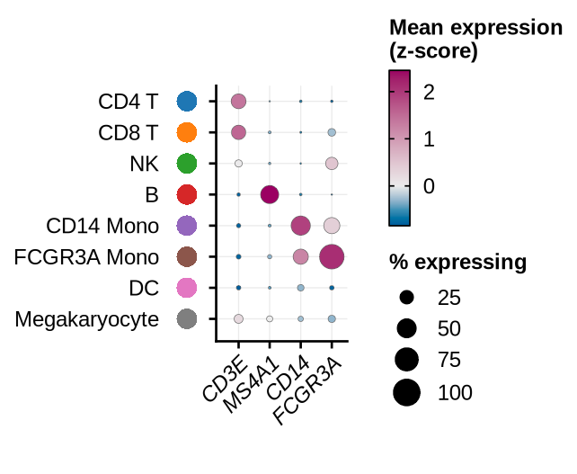

The same cells: the panel is twice as wide, every dot the same size.

``` r

genes_8 <- c("CD3E", "CD8A", "NKG7", "MS4A1", "CD14", "FCGR3A", "FCER1A", "PPBP")
DotPlot_bioToolkit(pbmc, features = genes_8, group.by = "cell_type")
```

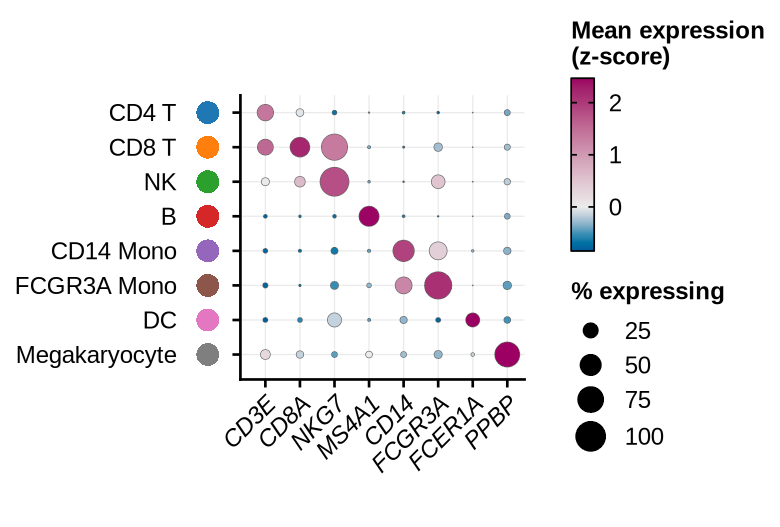

Larger cells make everything in them larger; dots scale with the cell
size:

``` r

DotPlot_bioToolkit(
    pbmc,
    features = c("CD3E", "MS4A1", "CD14", "FCGR3A"),
    group.by = "cell_type",
    cell.width = 0.3,
    cell.height = 0.25
)
```

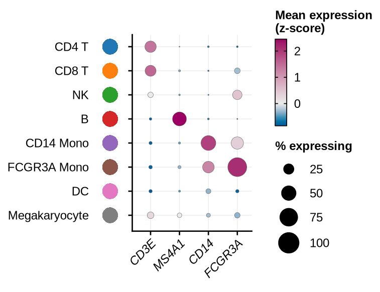

[`panel_size_theme()`](https://j-y26.github.io/bioToolkit/reference/panel_size_theme.md)
gives any ggplot the same behaviour:

``` r

ggplot(toy, aes(x, y)) +
    geom_point() +
    theme_bioToolkit() +
    panel_size_theme(panel.width = 3, panel.height = 1.5)
```


## Saving

[`save_plot()`](https://j-y26.github.io/bioToolkit/reference/save_plot.md)
measures the plot and writes a file that fits it, with nothing cropped
and no white margin. The format comes from the extension.

``` r

save_plot(p, "cell_types.pdf")   # vector, for journals and editing
save_plot(p, "cell_types.png")   # 1000 dpi raster
save_plot(p, "cell_types.jpg")   # no transparency: saved on white
```

PDFs and PNGs are both written with cairo, which embeds the fonts in
PDFs and keeps a hyphen as a hyphen (base
[`pdf()`](https://rdrr.io/r/grDevices/pdf.html) draws it as a wider
minus sign). Both use the same font, Arial by default; `family` picks
another, e.g. `save_plot(p, "cell_types.pdf", family = "Helvetica")`. A
font set in the theme (`base.family`) is kept.

Backgrounds are transparent by default (`bg = "transparent"` in every
plot), so figures can be placed on any slide or panel; `bg = "white"`
gives an opaque one. Patchworks keep the size of every panel:

``` r

p_cond <- DimPlot_bioToolkit(
    pbmc,
    group.by = "condition",
    cols = c("grey60", "#B5338A")
)
p | p_cond
```

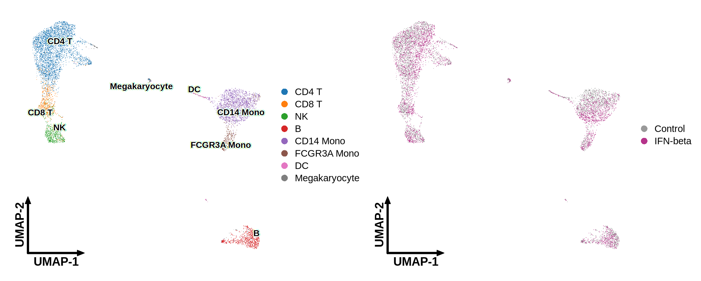

Dense layers (cells, genes of a volcano) are rasterized at 1000 dpi once
a plot has many points (`raster`, `raster.dpi`), so PDFs stay small
while axes and text stay vector.

## Legends as separate files

[`extract_legend()`](https://j-y26.github.io/bioToolkit/reference/extract_legend.md)
takes the legend out of a plot, for figures where one legend serves
several panels. By default the legend is exactly as drawn in the plot;
its arguments redraw it differently, with ggplot2’s own legend settings.

### Extracting

- As drawn
- `direction`
- `title.position`
- Restyled
- Several legends

``` r

extract_legend(p)
```

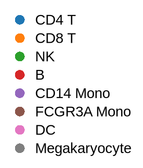

Keys in a row; several legends side by side:

``` r

extract_legend(p_cond, direction = "horizontal")
```


The titles to the left of the keys, here of a dot plot’s two legends:

``` r

p_dot <- DotPlot_bioToolkit(
    pbmc,
    features = c("CD3E", "MS4A1", "CD14"),
    group.by = "cell_type"
)
extract_legend(p_dot, title.position = "left")
```

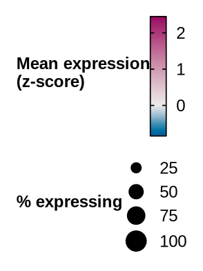

Any theme setting of the legend through `...`, e.g. smaller text, more
space between keys, two columns of keys (a ggplot2 guide):

``` r

two_cols <- guide_legend(ncol = 2, override.aes = list(size = 3))
p_two_cols <- p + guides(colour = two_cols)
extract_legend(
    p_two_cols,
    legend.text = element_text(size = 8),
    legend.key.spacing.y = unit(2, "pt"),
    legend.key.spacing.x = unit(8, "pt")
)
```

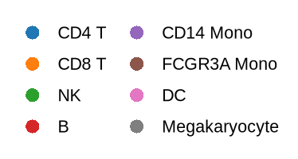

A plot with a colour bar and a size legend, e.g. a dot plot, gives both,
stacked or (`direction = "horizontal"`) side by side:

``` r

extract_legend(p_dot, direction = "horizontal")
```

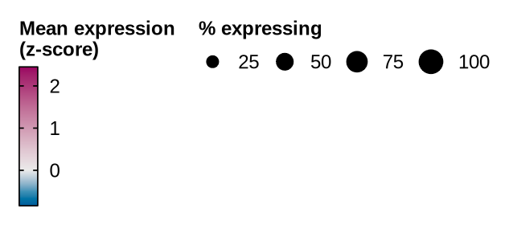

### Saving

Save the plot without its legend, and the legend on its own:

``` r

leg <- extract_legend(p_cond)
save_plot(p_cond + theme(legend.position = "none"), "umap.pdf")
save_plot(leg, "umap_legend.pdf")
```

## Source data

Journals increasingly ask for the data behind each figure.
[`export_source_data()`](https://j-y26.github.io/bioToolkit/reference/export_source_data.md)
writes the table a plot is drawn from (to CSV, or one sheet per plot of
a patchwork to XLSX) and returns it:

``` r

src <- export_source_data(p_cond)
head(src[[1]], 3)
#>                row        x          y    group highlight
#> 1 GCGGAGCTCTTACT-1 11.98873  0.4388136  Control      TRUE
#> 2 AACTACCTAAGCCT-1 12.34284 -2.1304214 IFN-beta      TRUE
#> 3 GAGGTTACACCTGA-1 10.95205 -1.5232978  Control      TRUE
```

``` r

export_source_data(p | p_cond, "figure_2a.xlsx")
```

For expression plots of a Seurat object, the table records the assay and
layer the values came from.

## Gene names in italics

Plots of genes set their names in italics by default
(`italic.genes = TRUE`) and leave metadata (e.g. `nCount_RNA`) upright.
For your own ggplots,
[`italic_labels()`](https://j-y26.github.io/bioToolkit/reference/italic_labels.md)
does the same for a discrete scale:

``` r

df <- data.frame(
    feature = c("CD3E", "MS4A1", "nCount_RNA"),
    value = c(3, 2, 1)
)
gene_labels <- function(x) italic_labels(x, x != "nCount_RNA")
ggplot(df, aes(value, feature)) +
    geom_col(width = 0.6) +
    scale_y_discrete(labels = gene_labels) +
    theme_bioToolkit() +
    panel_size_theme(2, 1)
```

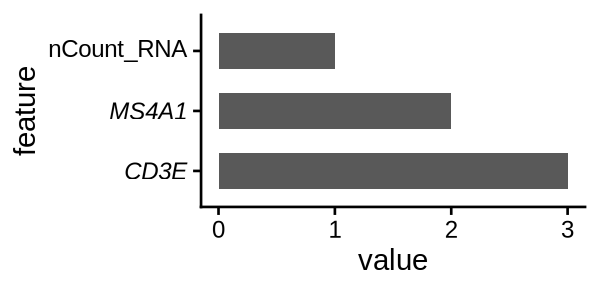

Symbols are drawn as given: human genes are upper case (`CD3E`), mouse
and rat genes title case (`Cd3e`). Check the case of your object’s gene
names before passing features.

## Colours

Every plot has one `cols` argument with a good default. It takes:

- for **groups** (cell types, conditions): a palette name, or colours
  named by group, or in the order of the group levels. The default is
  `"scanpy-20"` (up to 20 groups; `"scanpy-102"` beyond);
- for **continuous scales** (expression, scores, fold changes): a
  palette name, or colours from low to high, `c(low, high)` or
  `c(low, mid, high)`.

Diverging scales (z-scores, fold changes, NES) keep their centre colour
at 0 and stretch each side to its own end: when values run from -1 to 3,
-1 gets the full low colour and 3 the full high colour, rather than -1
sitting in the pale middle of a symmetric -3 to 3 scale. Colour depth is
then comparable within a side, not between sides; the colour bar shows
where 0 is.

### Picking colours

- By name
- Named colours
- Continuous

``` r

DimPlot_bioToolkit(pbmc, group.by = "cell_type", cols = "okabe-ito")
```

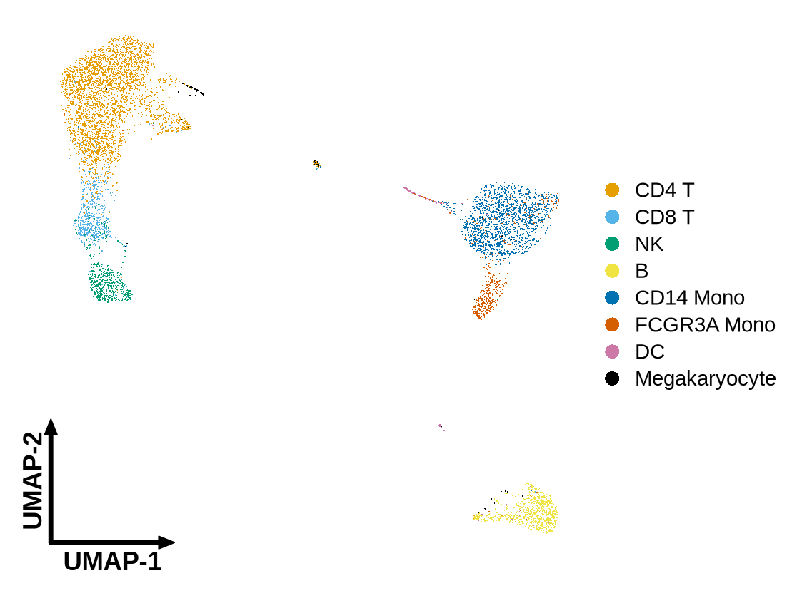

Pick colours by index (see
[`show_palettes()`](https://j-y26.github.io/bioToolkit/reference/show_palettes.md)
below), reorder them and name them by group, so that each cell type
keeps its colour in every figure:

``` r

cell_cols <- bt_palette("scanpy-20")[c(1, 2, 3, 5, 4, 6, 7, 8)]
names(cell_cols) <- levels(pbmc$cell_type)
DimPlot_bioToolkit(pbmc, group.by = "cell_type", cols = cell_cols)
```

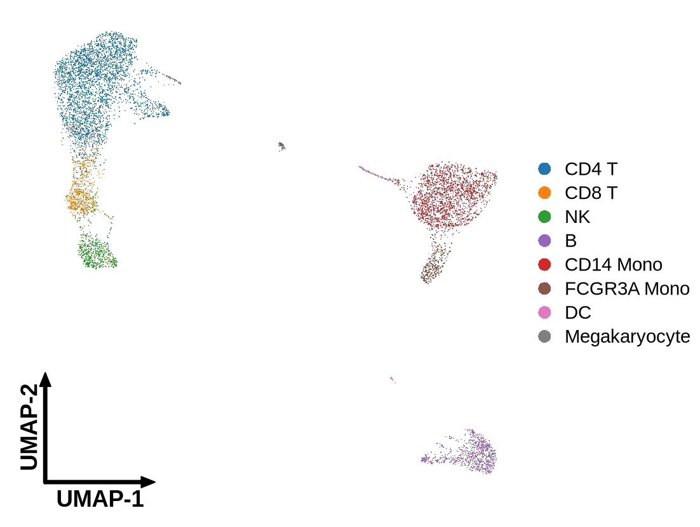

``` r

FeaturePlot_bioToolkit(
    pbmc,
    features = "ISG15",
    cols = c("grey90", "#B5338A")
)
```

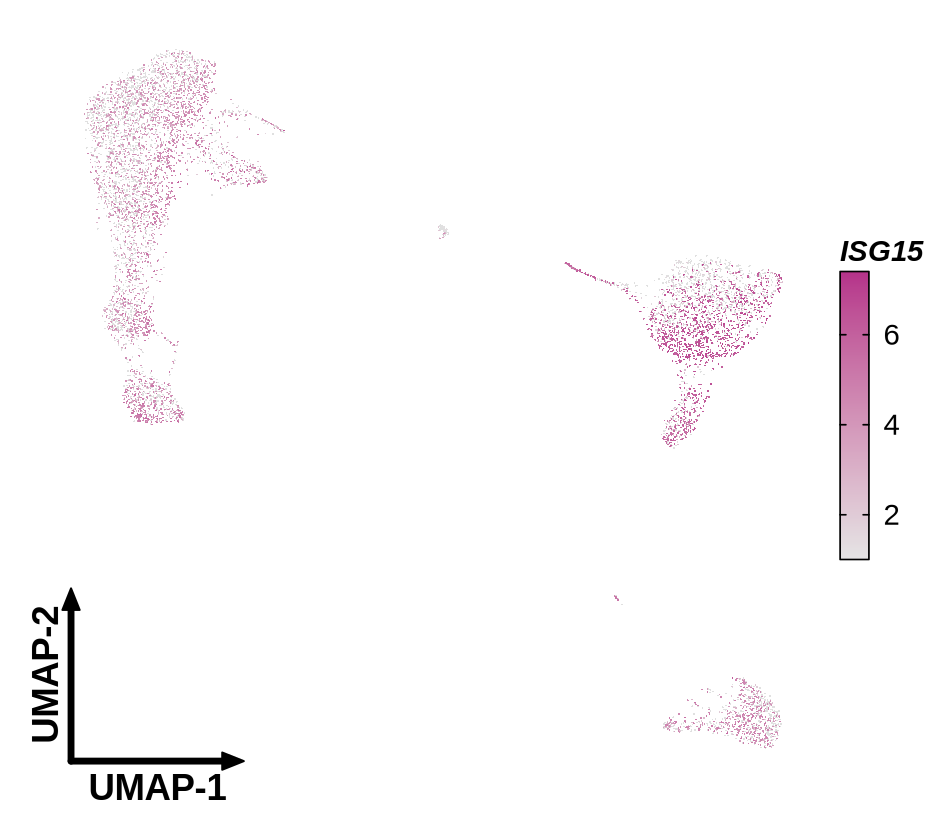

### Browsing palettes

Every palette, with the index and hex code of each colour, its source
and the plots that use it by default, is on the [Colour
palettes](https://j-y26.github.io/bioToolkit/articles/palettes.md) page.
In R,
[`list_palettes()`](https://j-y26.github.io/bioToolkit/reference/list_palettes.md)
lists the palettes with their type and source;
[`show_palettes()`](https://j-y26.github.io/bioToolkit/reference/show_palettes.md)
draws them with the index of each colour (also your own colours, or a
list of both), and
[`bt_palette()`](https://j-y26.github.io/bioToolkit/reference/bt_palette.md)
returns the colours. Add `_r` to any name to reverse it.

``` r

head(list_palettes("qualitative"))
#>           name        type   n
#> 1    scanpy-20 qualitative  20
#> 2 scanpy-20-cb qualitative  20
#> 3   scanpy-102 qualitative 102
#> 4    okabe-ito qualitative   8
#> 5   tol-bright qualitative   6
#> 6  tol-vibrant qualitative   6
#>                                                                                                                                                                            source
#> 1 matplotlib 'tab10' (the colours scanpy uses for up to 10 groups) followed by the 10 lighter 'tab20' tones; D3 category10 / category20 (M. Bostock). Default for up to 20 groups
#> 2                                      scanpy default_20 for 11-20 groups (Wolf et al. 2018, Genome Biol 19:15): tab20 without greys, three colours adjusted for colour-blindness
#> 3                                                                          scanpy default_102 ('godsnot_102', maximally distinct colours, black removed). Default above 20 groups
#> 4                                                                                    Okabe & Ito (2008), Color Universal Design; Wong (2011) Nat Methods 8:441. Colour-blind safe
#> 5                                                                        Paul Tol (2021), Colour schemes, SRON/EPS/TN/09-002, https://personal.sron.nl/~pault/. Colour-blind safe
#> 6                                                                        Paul Tol (2021), Colour schemes, SRON/EPS/TN/09-002, https://personal.sron.nl/~pault/. Colour-blind safe
```

``` r

show_palettes(c("scanpy-20", "okabe-ito", "npg"))
```

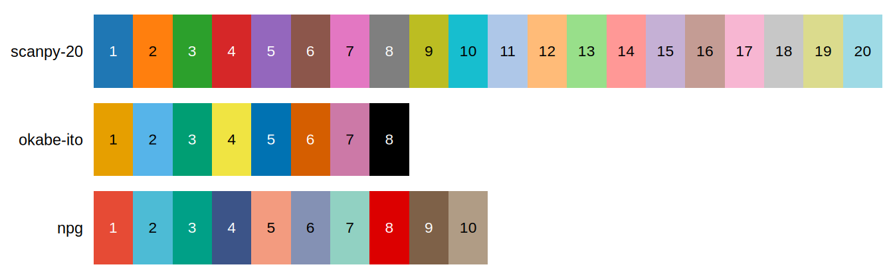

``` r

show_palettes(list(mine = cell_cols, "okabe-ito"))
```

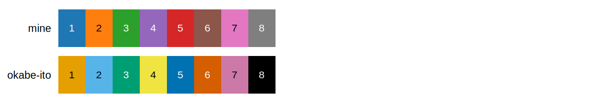

``` r

bt_palette("scanpy-20")[c(1, 3, 2)]
#> [1] "#1F77B4" "#2CA02C" "#FF7F0E"
bt_palette("viridis", n = 5)
#> [1] "#440154" "#3B528B" "#21908D" "#5DC863" "#FDE725"
```

### Colour vision deficiency

About 8% of men have red-green colour blindness.
[`check_palette()`](https://j-y26.github.io/bioToolkit/reference/check_palette.md)
simulates it and warns about pairs of colours that become hard to tell
apart:

``` r

check_palette(cell_cols)
#> Warning: 4 pair(s) of colours are hard to tell apart:
#>   #1F77B4 / #9467BD (deutan, Delta E 7.8)
#>   #2CA02C / #D62728 (deutan, Delta E 7.3)
#>   #1F77B4 / #9467BD (protan, Delta E 5.3)
#>   #FF7F0E / #2CA02C (protan, Delta E 4.8)
```

### Other colour helpers

``` r

# Weighted mix of colours
mix_colors(c("#2C5DA8", "#B5338A"))
#> [1] "#704899"
mix_colors(c("#2C5DA8", "#B5338A"), weights = c(3, 1))
#> [1] "#4E52A0"
# Order by hue
sort_colors_by_hue(bt_palette("okabe-ito"))
#> [1] "#D55E00" "#E69F00" "#F0E442" "#009E73" "#000000" "#56B4E9" "#0072B2"
#> [8] "#CC79A7"
# ggplot2's default hues
ggplot_colors(4)
#> [1] "#F8766D" "#7CAE00" "#00BFC4" "#C77CFF"
```

[`ggplot_colors()`](https://j-y26.github.io/bioToolkit/reference/ggplot_colors.md)
reproduces ggplot2’s default colours for `n` groups, e.g. to keep the
colours of plots made with Seurat’s defaults. (It was called
[`ggplotColours()`](https://j-y26.github.io/bioToolkit/reference/ggplotColours.md)
before 1.0.0; the old name still works, with a deprecation warning.)
