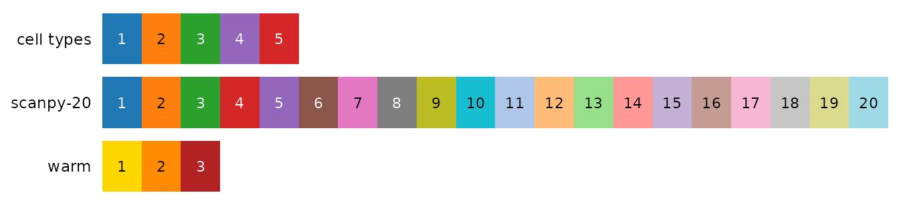

# Colour palettes

bioToolkit has 41 palettes, taken from published sources and credited
below. Every plot has one `cols` argument that takes a palette name, so
this page is the menu: pick a palette by name, or pick colours from it
by their index.

| To | Use |
|----|----|
| colour a plot with a palette | `cols = "okabe-ito"` |
| reverse a palette | add `_r` to its name: `cols = "viridis_r"` |
| take some colours, in your order | `bt_palette("scanpy-20")[c(1, 3, 2)]` (indices as shown below) |
| get `n` colours | `bt_palette("seq-blue", n = 5)` (qualitative palettes give their first `n`) |
| see palettes, or your own colours, in R | [`show_palettes()`](https://j-y26.github.io/bioToolkit/reference/show_palettes.md) |
| list names, types and sources | [`list_palettes()`](https://j-y26.github.io/bioToolkit/reference/list_palettes.md) |
| check colours for colour blindness | [`check_palette()`](https://j-y26.github.io/bioToolkit/reference/check_palette.md) |

Hover a swatch to see its index and hex code. Qualitative palettes are
for groups (cell types, conditions); sequential palettes for values from
low to high (expression, significance); diverging palettes for values on
both sides of a centre (fold changes, z-scores, NES).

## Defaults

The plots use these palettes when `cols` is not given:

| Values | Default | Used by |
|----|----|----|
| Groups, up to 20 | [`scanpy-20`](#palette-scanpy-20) | every plot coloured by group |
| Groups, 21 to 102 | [`scanpy-102`](#palette-scanpy-102) | every plot coloured by group |
| Expression on an embedding | [`plasma_r`](#palette-plasma) | [`FeaturePlot_bioToolkit()`](https://j-y26.github.io/bioToolkit/reference/FeaturePlot_bioToolkit.md) |
| Mean expression, not scaled | [`viridis_r`](#palette-viridis) | [`DotPlot_bioToolkit()`](https://j-y26.github.io/bioToolkit/reference/DotPlot_bioToolkit.md) |
| Mean expression, not scaled, heatmap | [`magma`](#palette-magma) | [`DoHeatmap_bioToolkit()`](https://j-y26.github.io/bioToolkit/reference/DoHeatmap_bioToolkit.md) |
| Significance, one-directional values | [`seq-purple`](#palette-seq-purple), [`seq-blue`](#palette-seq-blue), … | enrichment plots (one hue per panel), [`plot_pca()`](https://j-y26.github.io/bioToolkit/reference/plot_pca.md), [`plot_variance_explained()`](https://j-y26.github.io/bioToolkit/reference/plot_variance_explained.md) |
| Signed values (z-scores, fold changes, NES) | [`blue-magenta`](#palette-blue-magenta) | dot plots, DE plots, enrichment NES, density differences, diverging feature plots |
| z-scores of single cells | [`teal-yellow`](#palette-teal-yellow) | [`DoHeatmap_bioToolkit()`](https://j-y26.github.io/bioToolkit/reference/DoHeatmap_bioToolkit.md) |

## Qualitative

For groups. They are never interpolated: a colour in between two group
colours would read as an intermediate group, so `bt_palette(name, n)`
stops when a palette has fewer than `n` colours.

`scanpy-20`20 colours

1234567891011121314151617181920

matplotlib ‘tab10’ (the colours scanpy uses for up to 10 groups)
followed by the 10 lighter ‘tab20’ tones; D3 category10 / category20 (M.
Bostock). Default for up to 20 groups

`scanpy-20-cb`20 colours

1234567891011121314151617181920

scanpy default_20 for 11-20 groups (Wolf et al. 2018, Genome Biol
19:15): tab20 without greys, three colours adjusted for colour-blindness

`scanpy-102`102 colours

123456789101112131415161718192021222324252627282930313233343536373839404142434445464748495051525354555657585960616263646566676869707172737475767778798081828384858687888990919293949596979899100101102

scanpy default_102 (‘godsnot_102’, maximally distinct colours, black
removed). Default above 20 groups

`okabe-ito`8 colours

12345678

Okabe & Ito (2008), Color Universal Design; Wong (2011) Nat Methods
8:441. Colour-blind safe

`tol-bright`6 colours

123456

Paul Tol (2021), Colour schemes, SRON/EPS/TN/09-002,
<https://personal.sron.nl/~pault/>. Colour-blind safe

`tol-vibrant`6 colours

123456

Paul Tol (2021), Colour schemes, SRON/EPS/TN/09-002,
<https://personal.sron.nl/~pault/>. Colour-blind safe

`tol-muted`9 colours

123456789

Paul Tol (2021), Colour schemes, SRON/EPS/TN/09-002,
<https://personal.sron.nl/~pault/>. Colour-blind safe

`tol-light`8 colours

12345678

Paul Tol (2021), Colour schemes, SRON/EPS/TN/09-002,
<https://personal.sron.nl/~pault/>. Colour-blind safe; light, for
annotation strips

`tol-high-contrast`3 colours

123

Paul Tol (2021), Colour schemes, SRON/EPS/TN/09-002,
<https://personal.sron.nl/~pault/>. Colour-blind safe; distinct in
greyscale

`npg`10 colours

12345678910

ggsci (N. Xiao), after the colours of Nature Publishing Group figures;
not an official journal palette

`aaas`10 colours

12345678910

ggsci (N. Xiao), after the colours of Science (AAAS) figures; not an
official journal palette

`nejm`8 colours

12345678

ggsci (N. Xiao), after the colours of New England Journal of Medicine
figures; not an official journal palette

`lancet`9 colours

123456789

ggsci (N. Xiao), after the colours of The Lancet figures; not an
official journal palette

`jama`7 colours

1234567

ggsci (N. Xiao), after the colours of JAMA figures; not an official
journal palette

`jco`10 colours

12345678910

ggsci (N. Xiao), after the colours of Journal of Clinical Oncology
figures; not an official journal palette

`tableau-10`10 colours

12345678910

Tableau 10 (Tableau Software), as in grDevices::palette.colors()

`polychrome-36`36 colours

123456789101112131415161718192021222324252627282930313233343536

Coombes et al. (2019) J Stat Softw 90(1), as in
grDevices::palette.colors(); Seurat’s ‘polychrome’

`alphabet`26 colours

1234567891011121314151617181920212223242526

Green-Armytage (2010), a colour alphabet, as in
grDevices::palette.colors(); Seurat’s ‘alphabet’

`paired`12 colours

123456789101112

ColorBrewer ‘Paired’ (C. Brewer), as in grDevices::palette.colors();
light / dark pairs

## Sequential

For values from low to high. The `seq-*` palettes are single-hue ramps
trimmed to the same lightness range (CIE L\* 80 to 30): not so pale that
low values vanish on white, not so dark that the hue is lost, and the
same value has the same lightness whatever the hue, so that panels in
different hues stay comparable.

`seq-purple`9 colours

123456789

grDevices::hcl.colors(“Purples 3”) (Zeileis et al. 2020, J Stat Softw
96(1)), trimmed to lightness L\* 80 to 30

`seq-blue`9 colours

123456789

grDevices::hcl.colors(“Blues 3”) (Zeileis et al. 2020, J Stat Softw
96(1)), trimmed to lightness L\* 80 to 30

`seq-teal`9 colours

123456789

grDevices::hcl.colors(“Mint”) (Zeileis et al. 2020, J Stat Softw 96(1)),
trimmed to lightness L\* 80 to 30

`seq-green`9 colours

123456789

grDevices::hcl.colors(“Greens 3”) (Zeileis et al. 2020, J Stat Softw
96(1)), trimmed to lightness L\* 80 to 30

`seq-orange`9 colours

123456789

grDevices::hcl.colors(“Oranges”) (Zeileis et al. 2020, J Stat Softw
96(1)), trimmed to lightness L\* 80 to 30

`seq-red`9 colours

123456789

grDevices::hcl.colors(“Reds 3”) (Zeileis et al. 2020, J Stat Softw
96(1)), trimmed to lightness L\* 80 to 30

`seq-magenta`9 colours

123456789

grDevices::hcl.colors(“Magenta”) (Zeileis et al. 2020, J Stat Softw
96(1)), trimmed to lightness L\* 80 to 30

`viridis`256 colours

viridisLite (Garnier et al.); matplotlib colour maps (van der Walt &
Smith)

`magma`256 colours

viridisLite (Garnier et al.); matplotlib colour maps (van der Walt &
Smith)

`inferno`256 colours

viridisLite (Garnier et al.); matplotlib colour maps (van der Walt &
Smith)

`plasma`256 colours

viridisLite (Garnier et al.); matplotlib colour maps (van der Walt &
Smith)

`cividis`256 colours

Nuñez et al. (2018) PLoS ONE 13:e0199239; via viridisLite

`mako`256 colours

seaborn, via viridisLite

`rocket`256 colours

seaborn, via viridisLite

`tol-iridescent`23 colours

1234567891011121314151617181920212223

Paul Tol (2021), Colour schemes, SRON/EPS/TN/09-002,
<https://personal.sron.nl/~pault/>

`tol-ylorbr`9 colours

123456789

Paul Tol (2021), Colour schemes, SRON/EPS/TN/09-002,
<https://personal.sron.nl/~pault/>

## Diverging

For values on both sides of a centre, drawn in the middle colour. The
plots put the centre at 0 and stretch each side to its own end (see
[Colours](https://j-y26.github.io/bioToolkit/articles/figures.html#colours)).
Index 1 is the low end; for a scale of your own, the low, middle and
high colours are e.g. `bt_palette("tol-burd")[c(1, 5, 9)]`.

`blue-magenta`11 colours

1234567891011

bioToolkit; the sides stay distinct with red-green colour-blindness.
Default diverging

`blue-purple`11 colours

1234567891011

bioToolkit; truer purple, but both sides look blue with red-green
colour-blindness

`teal-yellow`11 colours

1234567891011

bioToolkit; RGB ramp \#00CED1 - black - \#FFE800, built as Seurat’s
PurpleAndYellow() (magenta - black - yellow). Default of
DoHeatmap_bioToolkit() for cells

`tol-sunset`11 colours

1234567891011

Paul Tol (2021), Colour schemes, SRON/EPS/TN/09-002,
<https://personal.sron.nl/~pault/>

`tol-burd`9 colours

123456789

Paul Tol (2021), Colour schemes, SRON/EPS/TN/09-002,
<https://personal.sron.nl/~pault/> (same colours as ColorBrewer RdBu,
reversed)

`tol-prgn`9 colours

123456789

Paul Tol (2021), Colour schemes, SRON/EPS/TN/09-002,
<https://personal.sron.nl/~pault/> (same colours as ColorBrewer PRGn)

## Your own colours

[`show_palettes()`](https://j-y26.github.io/bioToolkit/reference/show_palettes.md)
draws palettes by name, a vector of your own colours, or a list of both,
with the index of each colour. For example, colours picked for cell
types next to the palette they came from:

``` r

cell_cols <- bt_palette("scanpy-20")[c(1, 2, 3, 5, 4)]
names(cell_cols) <- c("CD4 T", "CD14 Mono", "B", "CD8 T", "NK")

show_palettes(list(
    "cell types" = cell_cols,
    "scanpy-20",
    warm = c("gold", "darkorange", "firebrick")
))
```



Name the colours by group and pass them as `cols`, so that each cell
type keeps its colour in every figure; `check_palette(cell_cols)` flags
pairs that become hard to tell apart with colour blindness (see [Colour
vision
deficiency](https://j-y26.github.io/bioToolkit/articles/figures.html#colour-vision-deficiency)).

## Adding a palette

New palettes come from a citable source, with hex values copied from it
(or from a package that reproduces it), never retyped from memory. Each
is an entry of
[`palette_list()`](https://j-y26.github.io/bioToolkit/reference/palette_list.md)
in `R/palettes.R`, with its colours, type and source; the package tests
check every entry.
