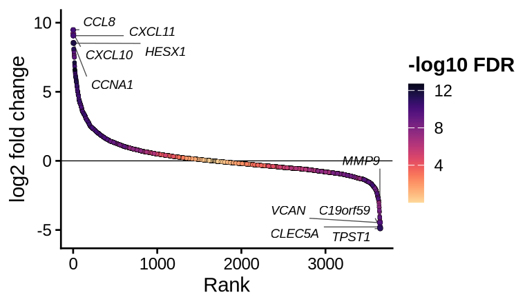
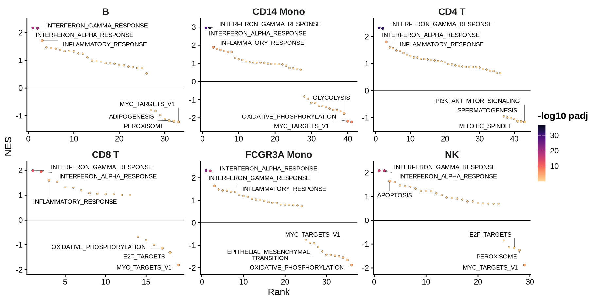
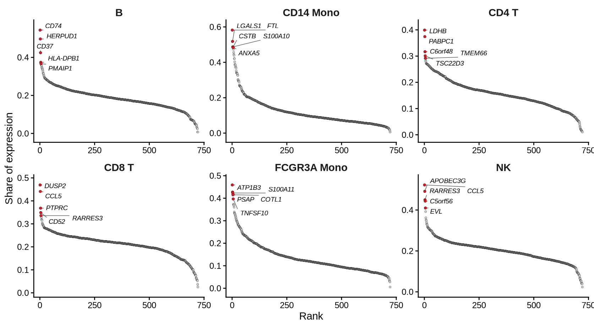
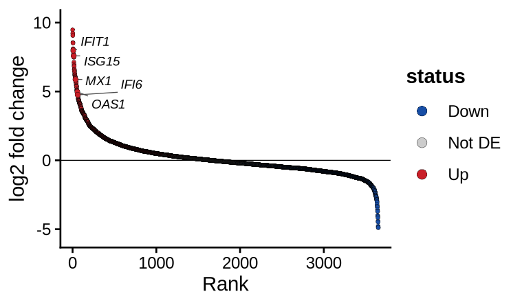
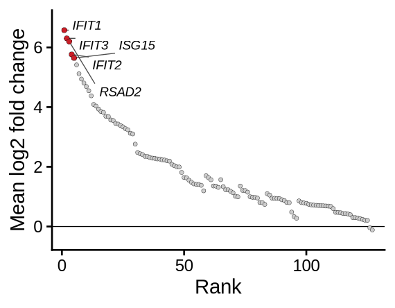
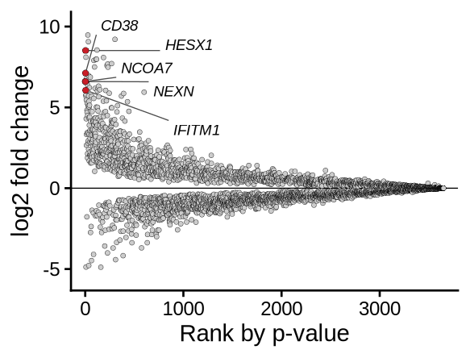

# Ranked values

**Question:** which features top (or end) a ranking, and how steeply
does the metric fall away from them?

| Function | Shows | Best for |
|----|----|----|
| [`plot_rank()`](https://j-y26.github.io/bioToolkit/reference/plot_rank.md) | features along their rank (x) against a value (y), the ends of the ranking named | any rankable metric: fold changes, NES, specificity scores (e.g. SCENIC’s regulon specificity), reporter metabolite z-scores |

[`plot_rank()`](https://j-y26.github.io/bioToolkit/reference/plot_rank.md)
takes any table: `rank.by` is the column the features are ranked by,
`value` the column drawn on y (by default the same). It is drawn small
(2.5 × 1.8 in panels), to fit in a corner of a figure, and its labels
are smaller than the tick labels (7 pt, less when they do not fit).

**Data:** interferon-β (IFN-β) vs control in each cell type of the PBMCs
of [Kang et al. 2018](https://doi.org/10.1038/nbt.4042) (pseudobulk,
edgeR; see [DE: many
comparisons](https://j-y26.github.io/bioToolkit/articles/de-multi.md)),
and the MSigDB Hallmark gene sets.

``` r

de <- docs_kang_de()
names(de)
#> [1] "CD4 T"       "CD8 T"       "NK"          "B"           "CD14 Mono"  
#> [6] "FCGR3A Mono"
# Symbols shared by several genes carry their Ensembl ID ("CCL5_ENSG...");
# the symbol alone is shown
symbol <- function(x) sub("_ENSG[0-9]+$", "", x)
mono <- de[["CD14 Mono"]]
mono$gene <- symbol(rownames(mono))
mono$neg_log10_fdr <- -log10(mono$FDR)
```

## Rank plot

Genes of CD14 monocytes ranked by their log2 fold change, coloured by
the −log10 FDR. The fold change has both signs, so both ends are named
(`label.side = "auto"`): the most induced and the most repressed genes.

``` r

plot_rank(
    mono,
    rank.by = "logFC",
    feature.col = "gene",
    color.by = "neg_log10_fdr",
    italic.genes = TRUE,
    y.title = "log2 fold change",
    legend.title = "-log10 FDR"
)
```



Each label sits next to its gene, in the corner the curve leaves empty
(towards higher ranks at the top end, lower ranks at the bottom end),
clear of the other labels, the points and the leader lines. Labels are
placed for the panel size, so set it with `panel.width` /
`panel.height`.

**Ties.** Every feature gets its own position, so tied features are
never drawn on top of each other. Ties are broken by `value`, then by
name (never by the row order of the table), and the source data hold
both the position (`rank`) and the tied rank to report (`rank_tied`: 1,
2, 2, 4).

### Variants

- `split.by`
- One-signed metric
- `label = "selected"`
- Ties
- `decreasing = FALSE`

One ranking per level, one panel each: here the NES of the Hallmark gene
sets in each cell type (fgsea on the signed −log10 p-value, as in
[Gene-set
enrichment](https://j-y26.github.io/bioToolkit/articles/enrichment.md)),
three named at each end.

``` r

hallmark <- docs_hallmark()
hallmark_list <- split(hallmark$gene_symbol, hallmark$gs_name)
signed_p <- function(t) {
    stats <- -log10(t$PValue) * sign(t$logFC)
    sort(setNames(stats, rownames(t)), decreasing = TRUE)
}
set.seed(1)
gsea <- lapply(names(de), function(ct) {
    res <- fgsea::fgsea(
        hallmark_list,
        signed_p(de[[ct]]),
        minSize = 15,
        maxSize = 500,
        eps = 0
    )
    data.frame(
        set = sub("HALLMARK_", "", res$pathway),
        NES = res$NES,
        neg_log10_padj = -log10(res$padj),
        cell_type = ct
    )
})
gsea <- do.call(rbind, gsea)
plot_rank(
    gsea,
    rank.by = "NES",
    feature.col = "set",
    split.by = "cell_type",
    color.by = "neg_log10_padj",
    label.n = 3,
    ncol = 3,
    legend.title = "-log10 padj"
)
```



A specificity score is never negative and only its top matters, so only
the first ranks are named. Here, a simple one (in the spirit of SCENIC’s
regulon specificity score, not the same): each gene’s share of its
expression summed over the six cell types (mean CPM of the cell type’s
pseudobulk samples), for genes of at least 10 CPM somewhere.

``` r

genes <- Reduce(intersect, lapply(de, rownames))
cpm <- sapply(de, function(t) 2^t[genes, "logCPM"])
rownames(cpm) <- genes
cpm <- cpm[apply(cpm, 1, max) >= 10, ]
share <- cpm / rowSums(cpm)
spec <- data.frame(
    gene = rep(symbol(rownames(share)), ncol(share)),
    cell_type = rep(colnames(share), each = nrow(share)),
    share = as.vector(share)
)
plot_rank(
    spec,
    rank.by = "share",
    feature.col = "gene",
    split.by = "cell_type",
    ncol = 3,
    italic.genes = TRUE,
    y.title = "Share of expression"
)
```



Named features only, wherever they rank: here interferon-stimulated
genes, coloured by whether they are DE (`color.by` with a discrete
column).

``` r

mono$status <- ifelse(
    mono$FDR < 0.05,
    ifelse(mono$logFC > 0, "Up", "Down"),
    "Not DE"
)
plot_rank(
    mono,
    rank.by = "logFC",
    feature.col = "gene",
    color.by = "status",
    cols = c(Down = "#174EA6", "Not DE" = "grey80", Up = "#C91F28"),
    label = "selected",
    label.features = c("ISG15", "IFIT1", "MX1", "IFI6", "OAS1"),
    italic.genes = TRUE,
    y.title = "log2 fold change"
)
```



A metric with many ties: in how many of the six cell types each gene is
induced (FDR \< 0.05, log2 fold change \> 1), with the genes of each
count ordered by their mean fold change (`value`). The tied rank to
report is in the source data.

``` r

up <- sapply(de, function(t) {
    t[genes, "FDR"] < 0.05 & t[genes, "logFC"] > 1
})
breadth <- data.frame(
    gene = symbol(genes),
    n_cell_types = rowSums(up),
    mean_logfc = rowMeans(sapply(de, function(t) t[genes, "logFC"]))
)
breadth <- breadth[breadth$n_cell_types > 0, ]
p <- plot_rank(
    breadth,
    rank.by = "n_cell_types",
    value = "mean_logfc",
    feature.col = "gene",
    italic.genes = TRUE,
    y.title = "Mean log2 fold change"
)
p
```



``` r

src <- attr(p, "source_data")
head(src[order(src$rank), c("feature", "rank", "rank_tied", "rank_value", "value")])
#>     feature rank rank_tied rank_value    value
#> 123   IFIT1    1         1          6 6.579287
#> 124   IFIT3    2         1          6 6.303621
#> 125   RSAD2    3         1          6 6.197879
#> 126   IFIT2    4         1          6 5.764766
#> 127   ISG15    5         1          6 5.644795
#> 1     CMPK2    6         1          6 5.415203
```

Rank 1 is the smallest value, e.g. genes ranked by p-value, with their
fold change on y.

``` r

plot_rank(
    mono,
    rank.by = "PValue",
    value = "logFC",
    feature.col = "gene",
    decreasing = FALSE,
    label.side = "first",
    italic.genes = TRUE,
    x.title = "Rank by p-value",
    y.title = "log2 fold change"
)
```



## Notes

- **Which end is named.** `label.side = "auto"` names both ends of a
  signed metric (z-scores, fold changes, NES: both directions mean
  something) and the first ranks otherwise (specificity, −log10 p: the
  end of the ranking is not of interest). `"first"`, `"last"` and
  `"both"` choose directly.
- **Crowded panels.** When the labels do not fit at 7 pt, they are made
  smaller (to 5 pt, the same size in every panel); if they still do not
  fit, a warning suggests a smaller `label.n` or a larger panel. Long
  names are wrapped after spaces, hyphens, underscores or commas
  (`label.wrap`).
- **Shared colour scales.** `color.limits` fixes the colour scale, so
  that figures of several time points or conditions compare; values
  beyond it get the end colours.
