# Single-cell: comparing conditions

**Question:** between two conditions, do the proportions of cell types
change, and where on the embedding are cells gained or lost?

| Function | Use |
|----|----|
| [`summarize_group_meta()`](https://j-y26.github.io/bioToolkit/reference/summarize_group_meta.md) | counts and proportions per group, condition (and sample) |
| [`get_meta_pivot()`](https://j-y26.github.io/bioToolkit/reference/get_meta_pivot.md) | a quick two-way table of two metadata columns |
| [`plot_composition_scatter()`](https://j-y26.github.io/bioToolkit/reference/plot_composition_scatter.md) | proportion of each group in one condition against another |
| [`DensityDiffPlot_bioToolkit()`](https://j-y26.github.io/bioToolkit/reference/DensityDiffPlot_bioToolkit.md) | where on an embedding a condition has more or fewer cells |

These plots describe differences; they do not test them. Cells from one
sample are not independent replicates, so tests of composition must use
samples (e.g. propeller, scCODA, Milo).

**Data:** 8,000 PBMCs from [Kang et
al. 2018](https://doi.org/10.1038/nbt.4042), 8 donors, each sampled as
control and after 6 h of interferon-β (IFN-β): 16 samples.

``` r

pbmc <- docs_kang()
```

## Counting cells

[`summarize_group_meta()`](https://j-y26.github.io/bioToolkit/reference/summarize_group_meta.md)
counts the cells of each group per condition (and per sample with
`sample.by`) and their proportion of the condition’s cells. It takes a
Seurat object or its metadata.

``` r

comp <- summarize_group_meta(pbmc, group.by = "cell_type", split.by = "condition")
head(comp)
#>   condition       group count total       prop
#> 1   Control       CD4 T  1666  3957 0.42102603
#> 2   Control       CD8 T   348  3957 0.08794541
#> 3   Control          NK   275  3957 0.06949709
#> 4   Control           B   417  3957 0.10538287
#> 5   Control   CD14 Mono   907  3957 0.22921405
#> 6   Control FCGR3A Mono   228  3957 0.05761941
```

``` r

per_sample <- summarize_group_meta(
    pbmc,
    group.by = "cell_type",
    split.by = "condition",
    sample.by = "donor"
)
head(per_sample, 3)
#>   sample condition group count total       prop
#> 1   D101   Control CD4 T    85   287 0.29616725
#> 2   D101   Control CD8 T    23   287 0.08013937
#> 3   D101   Control    NK    21   287 0.07317073
```

[`get_meta_pivot()`](https://j-y26.github.io/bioToolkit/reference/get_meta_pivot.md)
gives a two-way table of any two columns, as counts or as percentages of
rows, columns or the total:

``` r

get_meta_pivot(pbmc$cell_type, pbmc$condition, type = "count")
#> # A tibble: 8 × 3
#>   row_metadata  Control `IFN-beta`
#>   <fct>           <int>      <int>
#> 1 CD4 T            1666       1753
#> 2 CD8 T             348        310
#> 3 NK                275        337
#> 4 B                 417        387
#> 5 CD14 Mono         907        859
#> 6 FCGR3A Mono       228        284
#> 7 DC                 65         72
#> 8 Megakaryocyte      51         41
get_meta_pivot(
    pbmc$cell_type,
    pbmc$condition,
    type = "percent",
    margin = "column"
)
#> # A tibble: 8 × 3
#>   row_metadata  Control `IFN-beta`
#>   <fct>           <dbl>      <dbl>
#> 1 CD4 T           42.1       43.4 
#> 2 CD8 T            8.79       7.67
#> 3 NK               6.95       8.34
#> 4 B               10.5        9.57
#> 5 CD14 Mono       22.9       21.2 
#> 6 FCGR3A Mono      5.76       7.02
#> 7 DC               1.64       1.78
#> 8 Megakaryocyte    1.29       1.01
```

## Composition scatter

Each group’s proportion in one condition (x) against the other (y), with
the y = x line: groups above it are more abundant in the y condition.

``` r

plot_composition_scatter(
    pbmc,
    group.by = "cell_type",
    split.by = "condition",
    x = "Control",
    y = "IFN-beta"
)
```

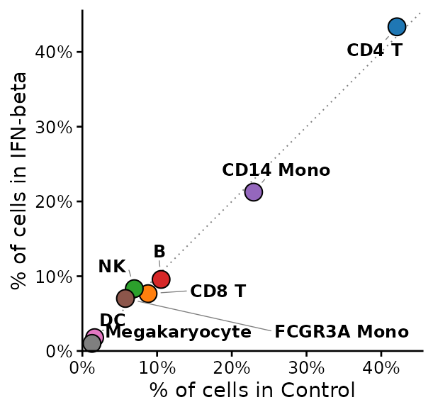

Six hours of IFN-β leave the cell type composition almost unchanged: all
cell types lie on the line. The response is a change of state, seen in
the expression of interferon-stimulated genes (see [Expression across
groups](https://j-y26.github.io/bioToolkit/articles/sc-expression.md)).

### Variants

- `sample.by`
- `log` and `fold.lines`
- `value = "count"`
- `facet.by`

Proportions per sample, each point the mean of a condition’s samples, so
that every donor counts the same. The horizontal bar is computed from
the samples of the x condition and the vertical bar from those of the y
condition: `error` chooses the SEM (default), the SD of the samples, or
a 95% confidence interval of the mean (`"ci95"`, mean ± t(0.975, n - 1)
× SEM, t-based since there are few samples per condition).

``` r

plot_composition_scatter(
    pbmc,
    group.by = "cell_type",
    split.by = "condition",
    sample.by = "donor"
)
```

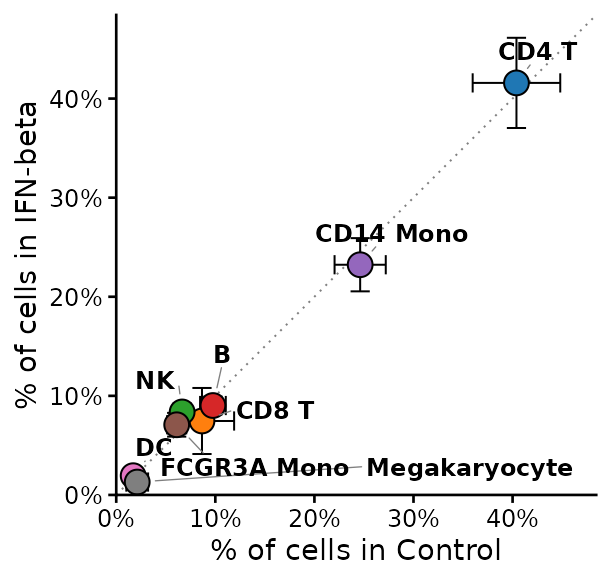

``` r

plot_composition_scatter(
    pbmc,
    group.by = "cell_type",
    split.by = "condition",
    sample.by = "donor",
    error = "ci95",
    log = TRUE
)
```

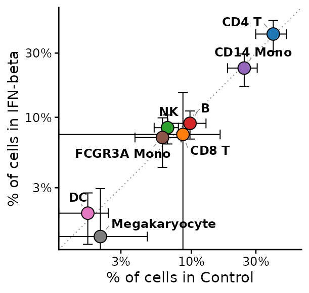

Log axes spread rare groups; `fold.lines = 2` draws y = 2x and y = x /
2:

``` r

plot_composition_scatter(
    pbmc,
    group.by = "cell_type",
    split.by = "condition",
    log = TRUE,
    fold.lines = 2
)
```

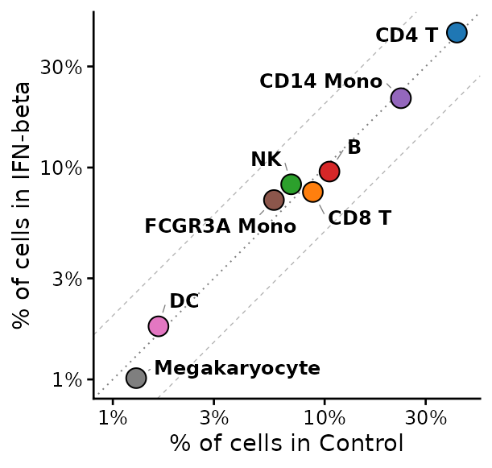

Numbers of cells instead of proportions:

``` r

plot_composition_scatter(
    pbmc,
    group.by = "cell_type",
    split.by = "condition",
    value = "count",
    log = TRUE
)
```

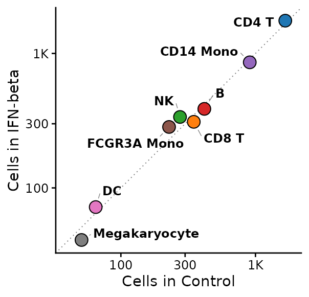

One panel per level of a third column, with proportions computed within
each, e.g. within lymphoid and myeloid cells:

``` r

is_lymphoid <- pbmc$cell_type %in% c("CD4 T", "CD8 T", "NK", "B")
pbmc$lineage <- factor(
    ifelse(is_lymphoid, "Lymphoid", "Myeloid"),
    levels = c("Lymphoid", "Myeloid")
)
plot_composition_scatter(
    pbmc,
    group.by = "cell_type",
    split.by = "condition",
    facet.by = "lineage",
    panel.width = 2.2,
    cells = colnames(pbmc)[pbmc$cell_type != "Megakaryocyte"]
)
```

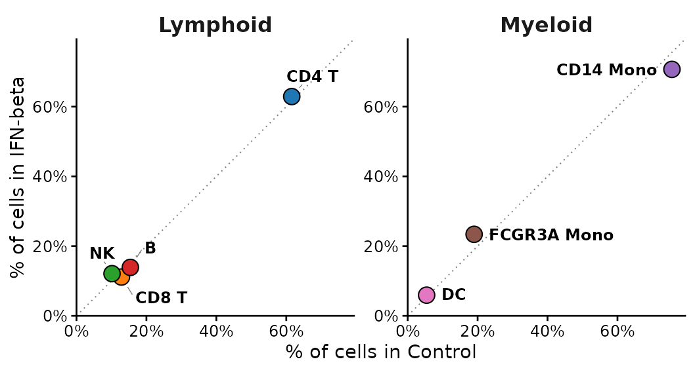

## Density difference on the embedding

[`DensityDiffPlot_bioToolkit()`](https://j-y26.github.io/bioToolkit/reference/DensityDiffPlot_bioToolkit.md)
estimates the density of cells of each condition on the embedding
(normalized, so cell numbers do not matter) and draws the difference
from a reference condition: magenta where the compared condition has
relatively more cells, blue where it has fewer. The colour scale is
centred on 0 and each side reaches its full colour at its own extreme.
With `sample.by`, each sample’s density is computed separately and
averaged, so one large sample cannot drive the map.

What the map means depends on the embedding. On the **integrated** UMAP
(Harmony over condition), cells of both conditions are aligned by cell
type, so the map shows shifts within cell types:

``` r

DensityDiffPlot_bioToolkit(
    pbmc,
    split.by = "condition",
    reference = "Control",
    sample.by = "sample",
    label = TRUE,
    label.by = "cell_type"
)
```

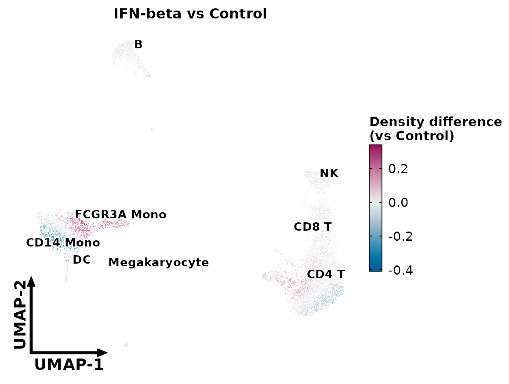

On the UMAP **before integration**, IFN-β-stimulated cells of every type
sit apart from their controls, and the map shows that response as a
separation:

``` r

DensityDiffPlot_bioToolkit(
    pbmc,
    split.by = "condition",
    reference = "Control",
    sample.by = "sample",
    reduction = "umap.unintegrated",
    label = TRUE,
    label.by = "cell_type"
)
```

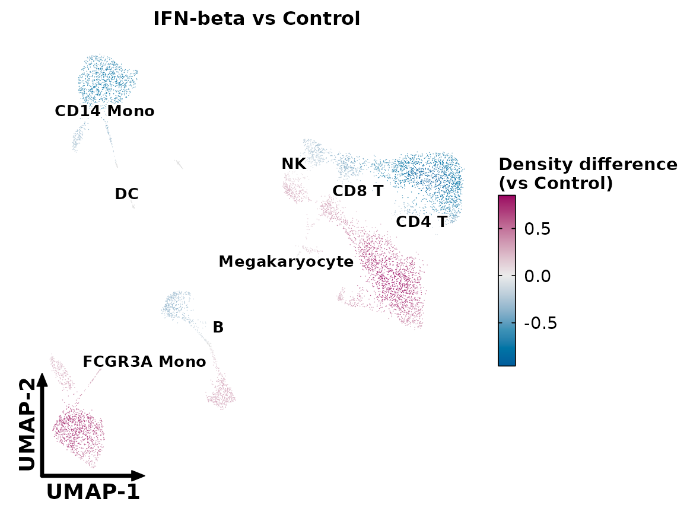

### Variants

- `measure = "log2ratio"`
- `draw = "raster"` and `contour`
- `density.adjust`

The log2 ratio of the two densities instead of their difference: fold
changes, which also show sparse regions.

``` r

DensityDiffPlot_bioToolkit(
    pbmc,
    split.by = "condition",
    reference = "Control",
    sample.by = "sample",
    measure = "log2ratio"
)
```

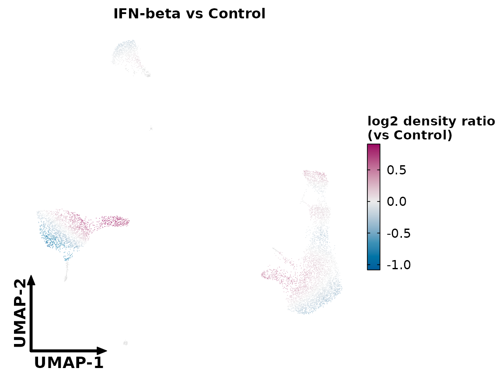

The density difference drawn as a continuous surface, with contours of
the density of all cells:

``` r

DensityDiffPlot_bioToolkit(
    pbmc,
    split.by = "condition",
    reference = "Control",
    sample.by = "sample",
    draw = "raster",
    contour = TRUE
)
```

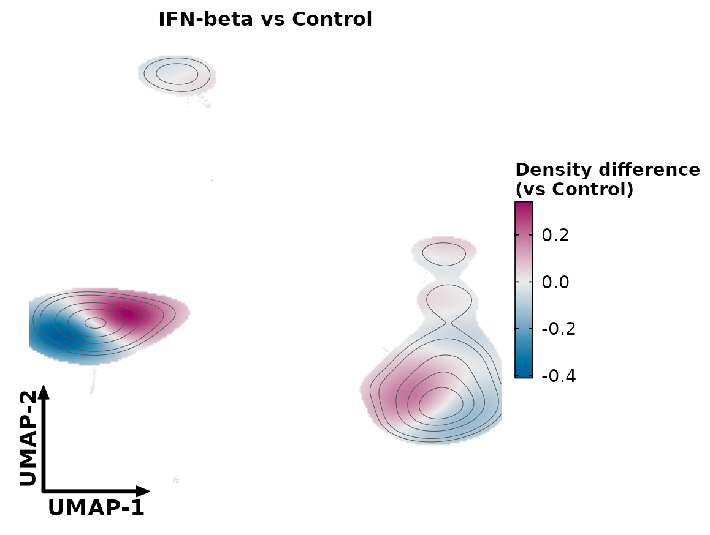

The bandwidth multiplier: below 1 resolves smaller regions, above 1
smooths more.

``` r

DensityDiffPlot_bioToolkit(
    pbmc,
    split.by = "condition",
    reference = "Control",
    sample.by = "sample",
    density.adjust = 0.5
)
```

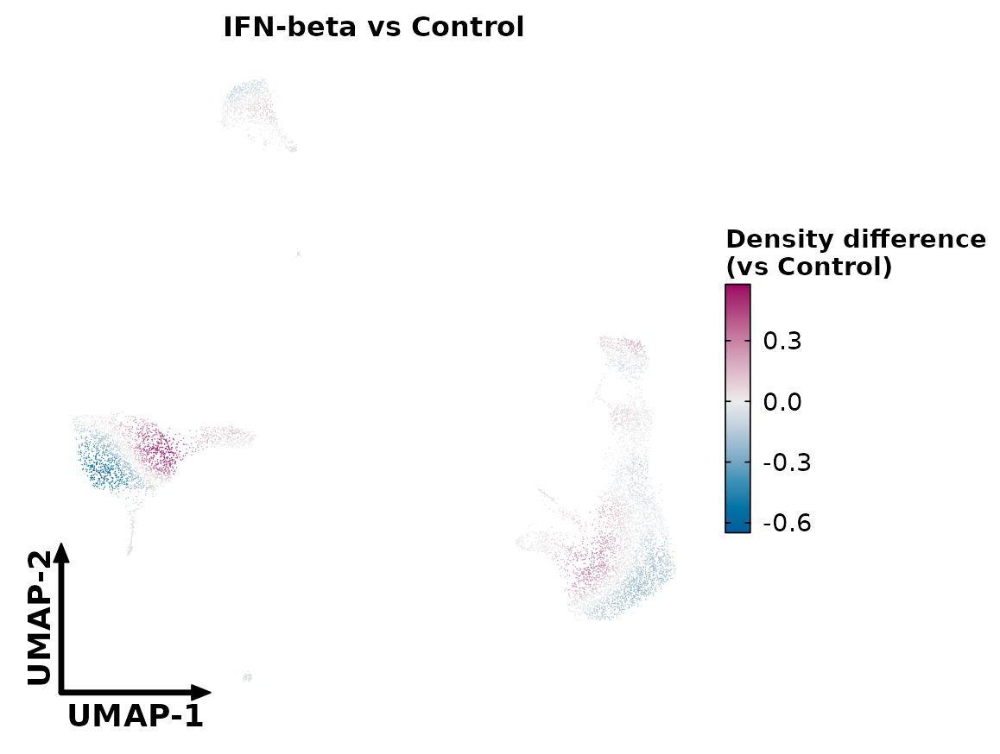
