# Single-cell: expression across groups

**Question:** which genes mark each group of cells, and how does a
gene’s expression differ between groups or conditions?

| Function | Shows | Best for |
|----|----|----|
| [`top_markers()`](https://j-y26.github.io/bioToolkit/reference/top_markers.md) | the top genes of each group from a marker table | choosing features |
| [`DotPlot_bioToolkit()`](https://j-y26.github.io/bioToolkit/reference/DotPlot_bioToolkit.md) | % of cells expressing (size) and mean expression (colour) | many genes × groups |
| [`VlnPlot_bioToolkit()`](https://j-y26.github.io/bioToolkit/reference/VlnPlot_bioToolkit.md) | per-cell distributions, with box and points | a few genes or QC metrics |
| [`RidgePlot_bioToolkit()`](https://j-y26.github.io/bioToolkit/reference/RidgePlot_bioToolkit.md) | per-cell distributions as density ridges | shapes of distributions, many groups |
| [`DoHeatmap_bioToolkit()`](https://j-y26.github.io/bioToolkit/reference/DoHeatmap_bioToolkit.md) | expression of each cell or group mean, z-scored | marker blocks, conditions within cell types |

All share **`group.by`** (the groups compared, marked by their colour)
and **`split.by`** (a higher-level grouping drawn as labelled blocks):
`group.by = "condition", split.by = "cell_type"` compares conditions
within each cell type. Note that Seurat’s `DotPlot()` / `VlnPlot()` use
`split.by` the other way round.

Blocks (`split.by`, and groups of genes given as a named list) are
marked the same way in every plot: a bar along the block, 3.5 pt thick
(`group.bar.width`), set a little off the grid, with the block’s name
beyond it. Bars are black by default; `split.by.cols` and
`feature.group.cols` colour them (a palette name, or colours named by
block). They sit opposite the axis labels by default (gene groups on top
when genes are the columns); `"labels"` in `split.by.side` /
`feature.group.side` moves them beyond the labels.

**Data:** 8,000 PBMCs from [Kang et
al. 2018](https://doi.org/10.1038/nbt.4042), control or interferon-β
(IFN-β) stimulated, with the authors’ cell types. Gene symbols are human
(upper case, e.g. `CD3E`).

``` r

pbmc <- docs_kang()
```

## Marker genes

[`top_markers()`](https://j-y26.github.io/bioToolkit/reference/top_markers.md)
reads a marker table (Seurat’s `FindAllMarkers()` or any DE table with a
group column) and returns the top genes of each group as a named list,
the `features` format of the dot plot and heatmap. With `unique = TRUE`
(default), a gene that marks several groups is kept for the group where
its fold change is largest.

``` r

markers <- Seurat::FindAllMarkers(
    pbmc,
    only.pos = TRUE,
    logfc.threshold = 0.5,
    min.pct = 0.1,
    verbose = FALSE
)
top <- top_markers(markers, n = 3)
str(top)
#> List of 8
#>  $ CD4 T        : chr [1:3] "LEF1" "ADTRP" "TSHZ2"
#>  $ CD8 T        : chr [1:3] "GZMH" "KLRG1" "LAG3"
#>  $ NK           : chr [1:3] "SH2D1B" "KLRF1" "LINC00996"
#>  $ B            : chr [1:3] "MS4A1" "LINC00926" "CD79A-ENSG00000105369"
#>  $ CD14 Mono    : chr [1:3] "SERPINB2" "S100A8" "S100A9"
#>  $ FCGR3A Mono  : chr [1:3] "VMO1" "CASP5" "CH25H"
#>  $ DC           : chr [1:3] "DNASE1L3" "FSCN1" "FCER1A"
#>  $ Megakaryocyte: chr [1:3] "GP9" "CLDN5" "PTCRA"
```

`rank.by = "logfc"` (default) favours genes specific to a group;
`rank.by = "padj"` favours broadly and strongly expressed genes, as
p-values grow with group size:

``` r

str(top_markers(markers, n = 3, rank.by = "padj")[1:3])
#> List of 3
#>  $ CD4 T: chr [1:3] "LTB-ENSG00000227507" "SELL" "LDHB"
#>  $ CD8 T: chr [1:3] "GZMH" "CD8A" "LAG3"
#>  $ NK   : chr [1:3] "GNLY" "CLIC3" "PRF1"
```

Per-cell tests (as `FindAllMarkers()`) treat cells as replicates: fine
to rank markers, but their p-values are not evidence for differences
between conditions; use pseudobulk tests for that (see [DE: many
comparisons](https://j-y26.github.io/bioToolkit/articles/de-multi.md)).

## Dot plot

``` r

DotPlot_bioToolkit(pbmc, features = top, group.by = "cell_type")
```

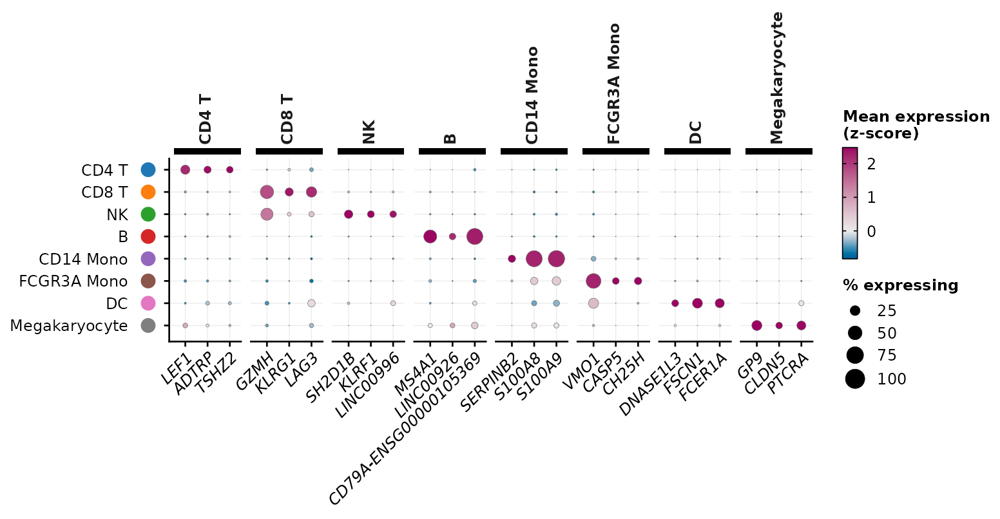

By default, each gene’s mean expression is z-scored across groups
(`scale`), so colours compare groups for a gene, not genes with each
other. The colour scale is centred on 0 and each side reaches its full
colour at its own most extreme value (at most ±2.5), so it need not be
symmetric. Groups are marked with the cell type colours of
[`DimPlot_bioToolkit()`](https://j-y26.github.io/bioToolkit/reference/DimPlot_bioToolkit.md);
the groups of genes by bars on top.

### Variants

- `split.by`
- Bar colours and sides
- `scale = FALSE`
- `flip`
- Clustering
- `average`

Interferon-stimulated genes in each condition (`group.by`, the dot
colours), within each cell type (`split.by`, the blocks, named on the
right):

``` r

isg <- c("ISG15", "IFI6", "IFIT1", "MX1", "CXCL10")
DotPlot_bioToolkit(
    pbmc,
    features = isg,
    group.by = "condition",
    split.by = "cell_type",
    group.cols = c("grey60", "#B5338A")
)
```

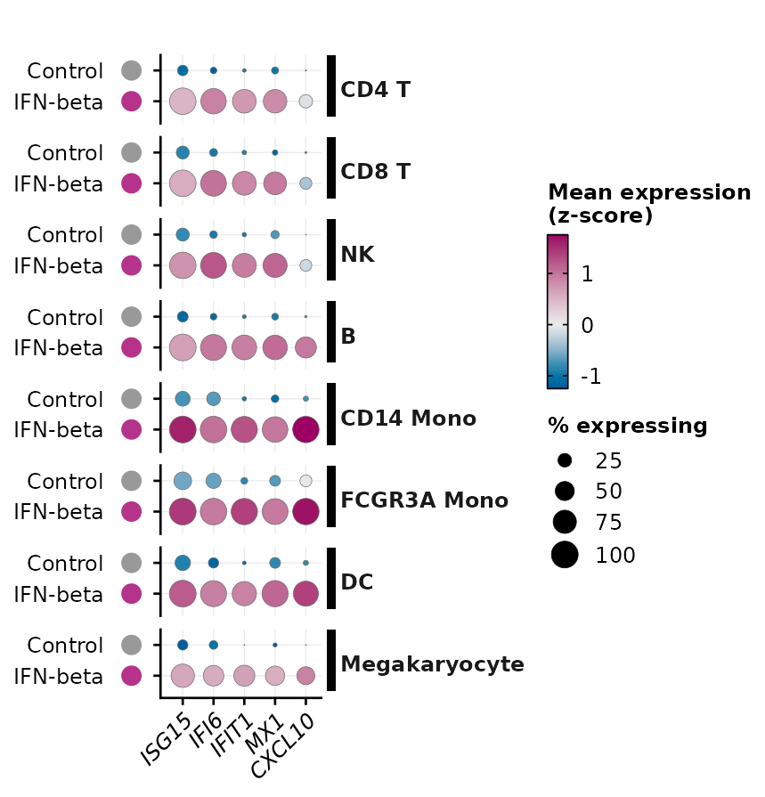

The gene groups take the cell type colours, and both groupings move
beyond the labels (`"labels"`):

``` r

cell_cols <- bt_palette("scanpy-20", nlevels(pbmc$cell_type))
names(cell_cols) <- levels(pbmc$cell_type)
DotPlot_bioToolkit(
    pbmc,
    features = top[1:4],
    group.by = "condition",
    split.by = "cell_type",
    group.cols = c("grey60", "#B5338A"),
    feature.group.cols = cell_cols,
    feature.group.side = "labels",
    split.by.cols = cell_cols,
    split.by.side = "labels"
)
```

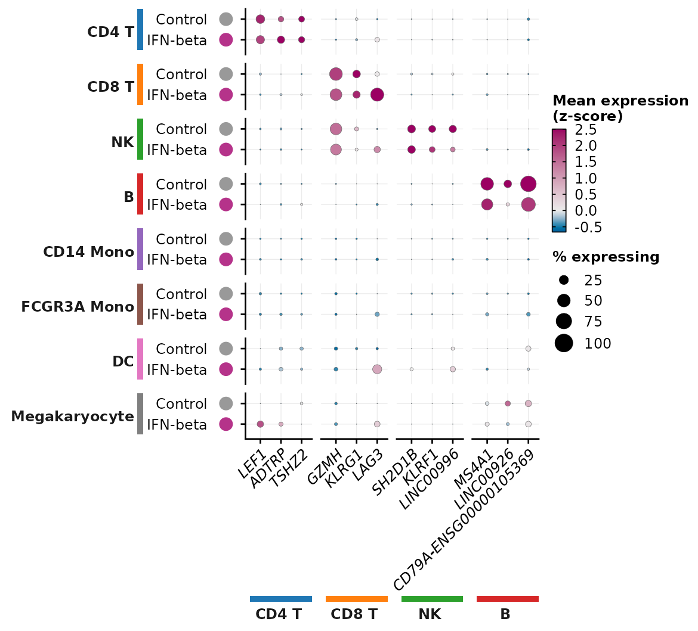

Unscaled mean expression (log-normalized), comparable between genes:

``` r

DotPlot_bioToolkit(pbmc, features = isg, group.by = "cell_type", scale = FALSE)
```

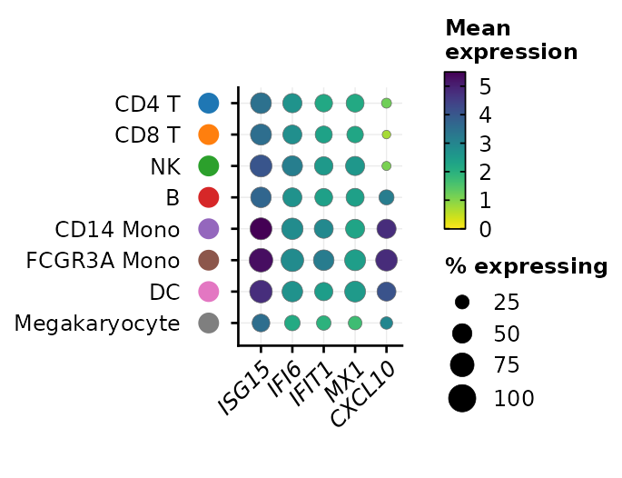

Genes as rows, groups as columns (the gene groups then on the right);
`group.marker = "strip"` draws colour strips instead of dots:

``` r

DotPlot_bioToolkit(
    pbmc,
    features = top[1:4],
    group.by = "cell_type",
    flip = TRUE,
    group.marker = "strip"
)
```

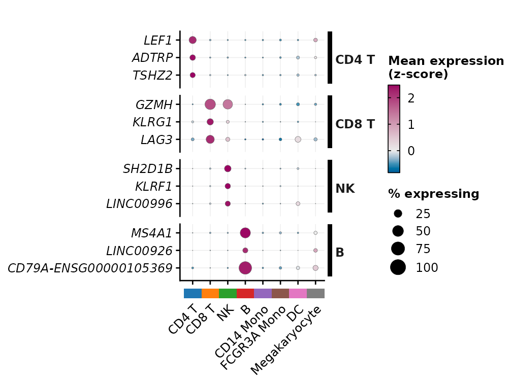

Order genes (within each gene group) and groups by hierarchical
clustering:

``` r

DotPlot_bioToolkit(
    pbmc,
    features = unlist(top, use.names = FALSE),
    group.by = "cell_type",
    cluster.features = TRUE,
    cluster.groups = TRUE
)
```

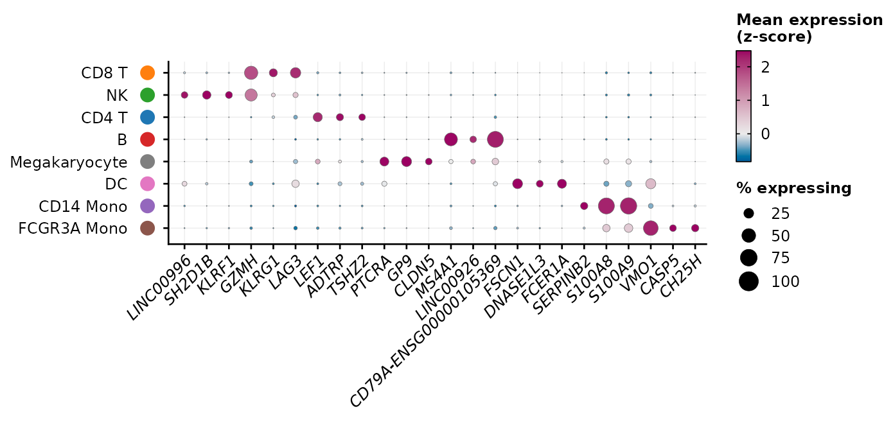

`average = "linear"` (default, as Seurat) is the log of the mean
normalized expression, a pseudobulk; `"log"` (as SCpubr) the mean of log
values, less driven by a few very high cells. `pct.min` hides dots of
groups with few expressing cells:

``` r

DotPlot_bioToolkit(
    pbmc,
    features = top,
    group.by = "cell_type",
    average = "log",
    pct.min = 5
)
```

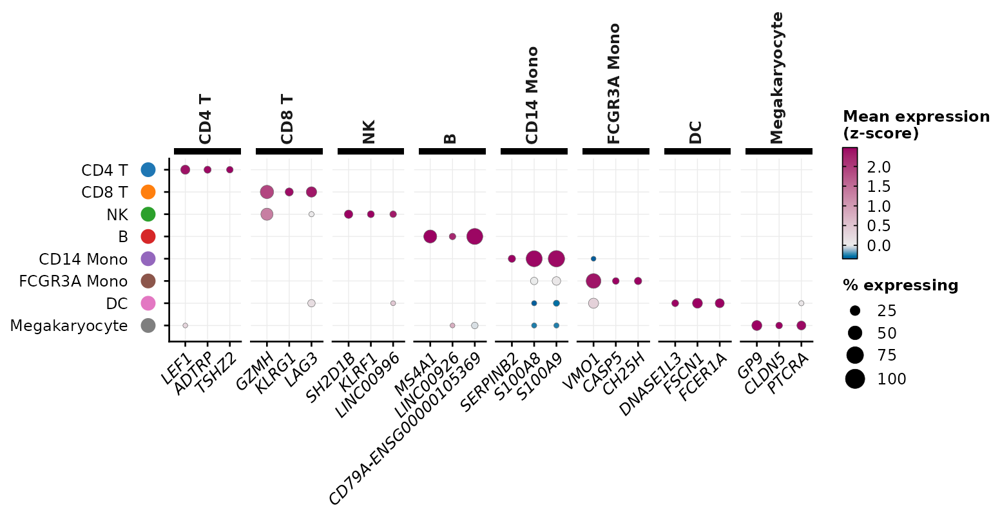

## Violin plot

``` r

VlnPlot_bioToolkit(pbmc, features = c("CD14", "LYZ"), group.by = "cell_type")
```

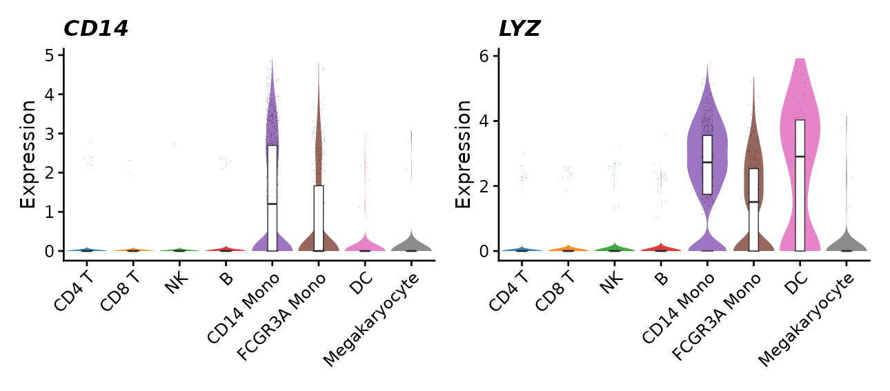

Each feature has its own panel and axis; points are a random sample of
at most `pt.n` cells per violin, rasterized.

### Variants

- QC metrics
- `split.by` and `zeros`
- `stack`
- `y.max`

Metadata columns work like genes, from the object or from a data frame
of per-cell values. `log` puts chosen features on a log10 axis:

``` r

VlnPlot_bioToolkit(
    pbmc[[]],
    features = c("nCount_RNA", "nFeature_RNA"),
    group.by = "sample",
    log = TRUE,
    flip = TRUE,
    pt.n = 300
)
```

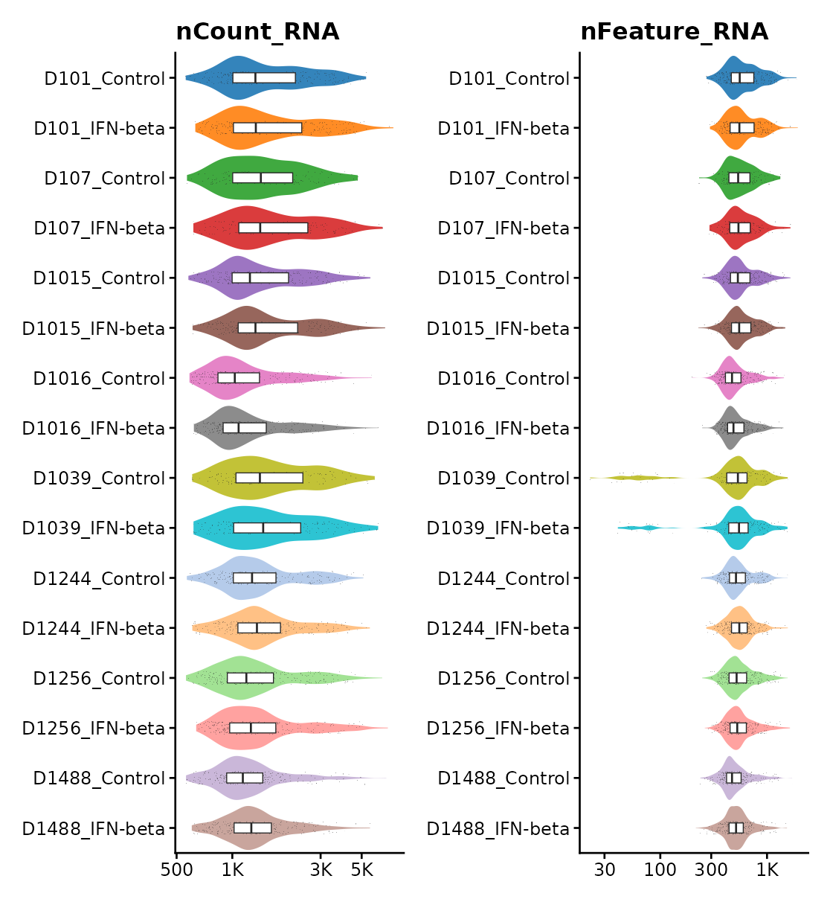

Sparse genes: most cells have 0 counts. `zeros = "annotate"` draws the
violins of the cells above 0 and prints the % of cells above 0, so that
both the fraction expressing and the level are visible. The cell type
blocks are marked by bars in their colours (`split.by.cols`):

``` r

VlnPlot_bioToolkit(
    pbmc,
    features = "CXCL10",
    group.by = "condition",
    split.by = "cell_type",
    zeros = "annotate",
    cols = c("grey60", "#B5338A"),
    split.by.cols = cell_cols
)
```

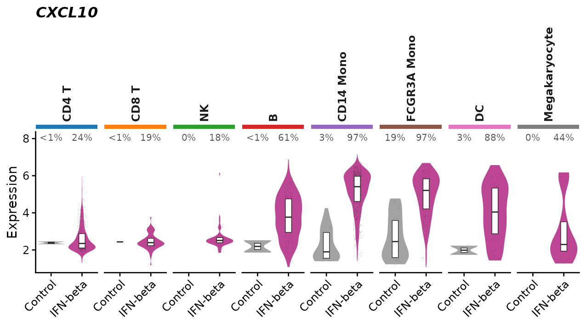

Many genes as thin rows sharing the group axis; `pt.n = 0` draws no
points:

``` r

VlnPlot_bioToolkit(
    pbmc,
    features = c("CD3E", "NKG7", "MS4A1", "CD14", "FCGR3A", "PPBP"),
    group.by = "cell_type",
    stack = TRUE,
    pt.n = 0
)
```

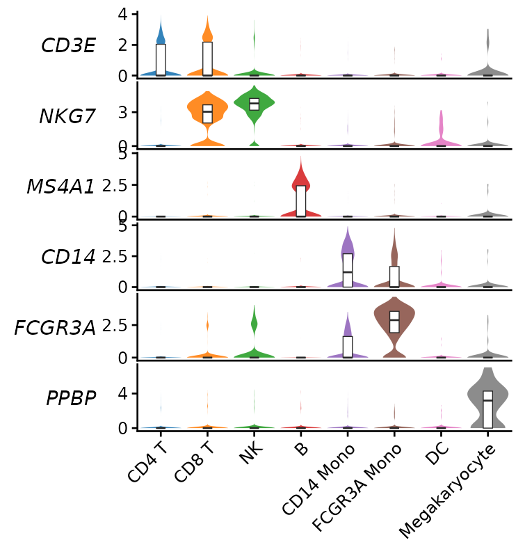

Zoom past a few extreme cells (`"q99"`: the 99th percentile). The
violins and boxes are computed from all cells and cut at the top of the
axis; points above it are not drawn:

``` r

VlnPlot_bioToolkit(
    pbmc,
    features = "nCount_RNA",
    group.by = "cell_type",
    y.max = "q99"
)
```

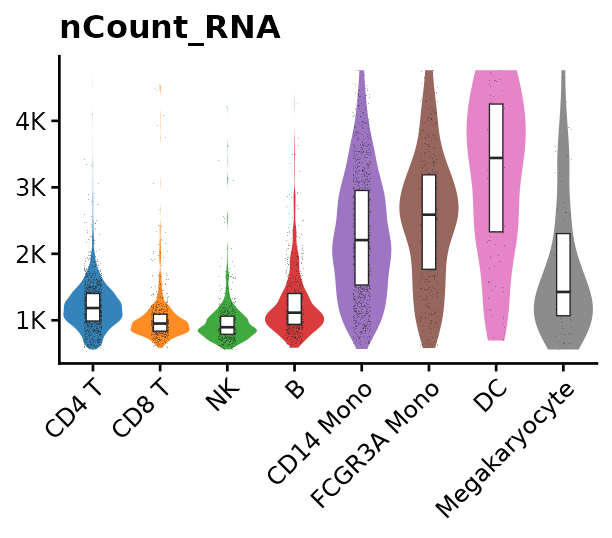

## Ridge plot

The same data arguments as the violin plot, drawn as density ridges.
Each ridge is scaled to its own height, so ridges compare shapes, not
cell numbers; `overlap` sets how far they overlap.

``` r

RidgePlot_bioToolkit(
    pbmc,
    features = c("ISG15", "nFeature_RNA"),
    group.by = "cell_type",
    overlap = 1.5
)
```

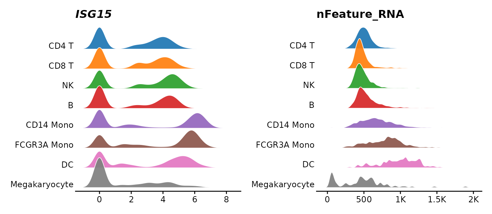

``` r

RidgePlot_bioToolkit(
    pbmc,
    features = "CXCL10",
    group.by = "cell_type",
    zeros = "annotate",
    cells = colnames(pbmc)[pbmc$condition == "IFN-beta"]
)
```

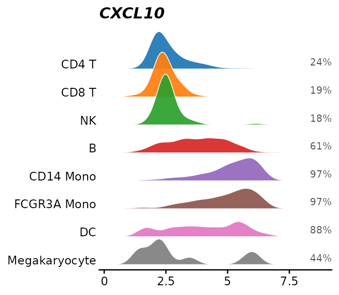

## Heatmap

Genes as rows, in blocks of the `features` list, each marked by a bar
opposite the gene names; columns are cells (at most `max.cells` per
group, so that small groups stay visible), z-scored per gene, in blocks
named on top. Any gene of the assay can be drawn, not only those in
`scale.data`.

``` r

DoHeatmap_bioToolkit(
    pbmc,
    features = top_markers(markers, n = 5),
    group.by = "cell_type",
    max.cells = 100
)
```

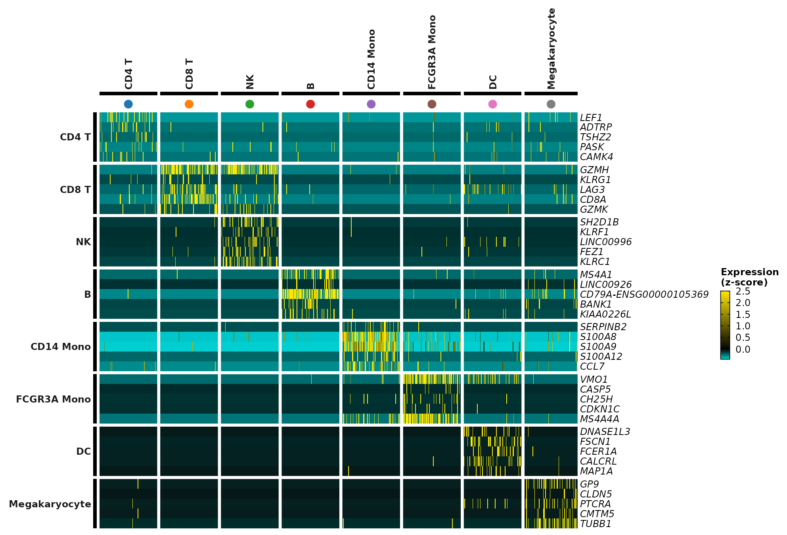

### Variants

- `columns = "groups"`
- Bar colours
- `annotations`
- `label.features`

One column per group mean: here conditions (dots) within cell types
(blocks). Group means use a light-centred diverging palette:

``` r

heat_genes <- list(
    "IFN-stimulated" = isg,
    "Markers" = c("CD3E", "MS4A1", "CD14")
)
DoHeatmap_bioToolkit(
    pbmc,
    features = heat_genes,
    group.by = "condition",
    split.by = "cell_type",
    columns = "groups",
    group.cols = c("grey60", "#B5338A")
)
```

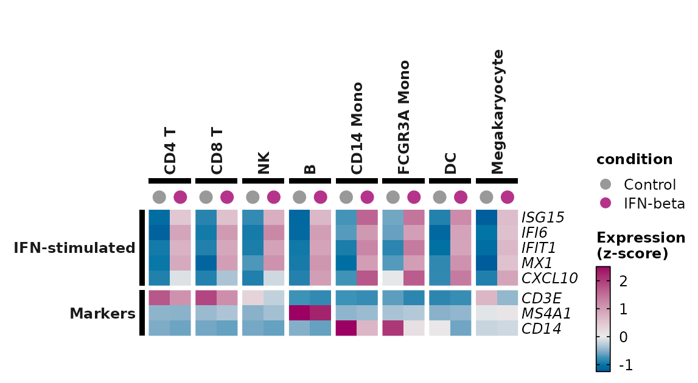

Blocks of genes and of columns in the cell type colours
(`feature.group.cols`, `split.by.cols`):

``` r

DoHeatmap_bioToolkit(
    pbmc,
    features = top_markers(markers, n = 4),
    group.by = "cell_type",
    max.cells = 100,
    group.marker = "none",
    feature.group.cols = cell_cols,
    split.by.cols = cell_cols
)
```

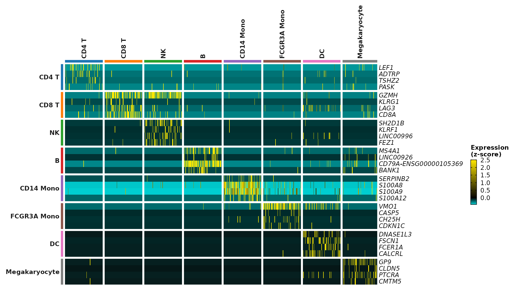

Further metadata as colour strips above the columns, e.g. the donor of
each cell:

``` r

mono <- colnames(pbmc)[pbmc$cell_type == "CD14 Mono"]
DoHeatmap_bioToolkit(
    pbmc,
    features = isg,
    cells = mono,
    group.by = "condition",
    annotations = "donor",
    max.cells = 150,
    group.cols = c("grey60", "#B5338A")
)
```

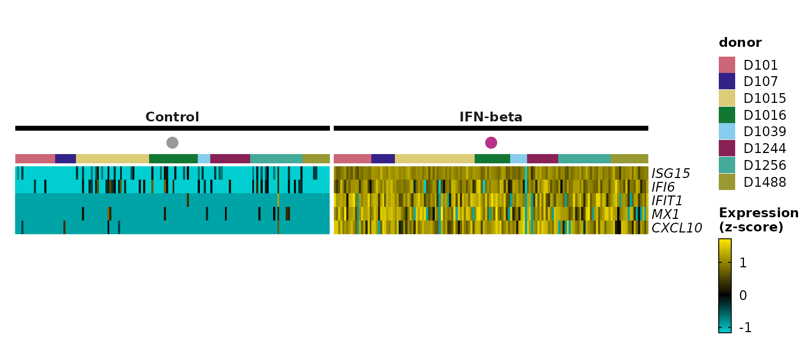

For many genes, names are hidden when rows are too thin; name a few with
leader lines:

``` r

top20 <- top_markers(markers, n = 20)
first_genes <- vapply(top20, `[`, "", 1)   # first gene of each group
DoHeatmap_bioToolkit(
    pbmc,
    features = top20,
    group.by = "cell_type",
    max.cells = 100,
    label.features = first_genes
)
```

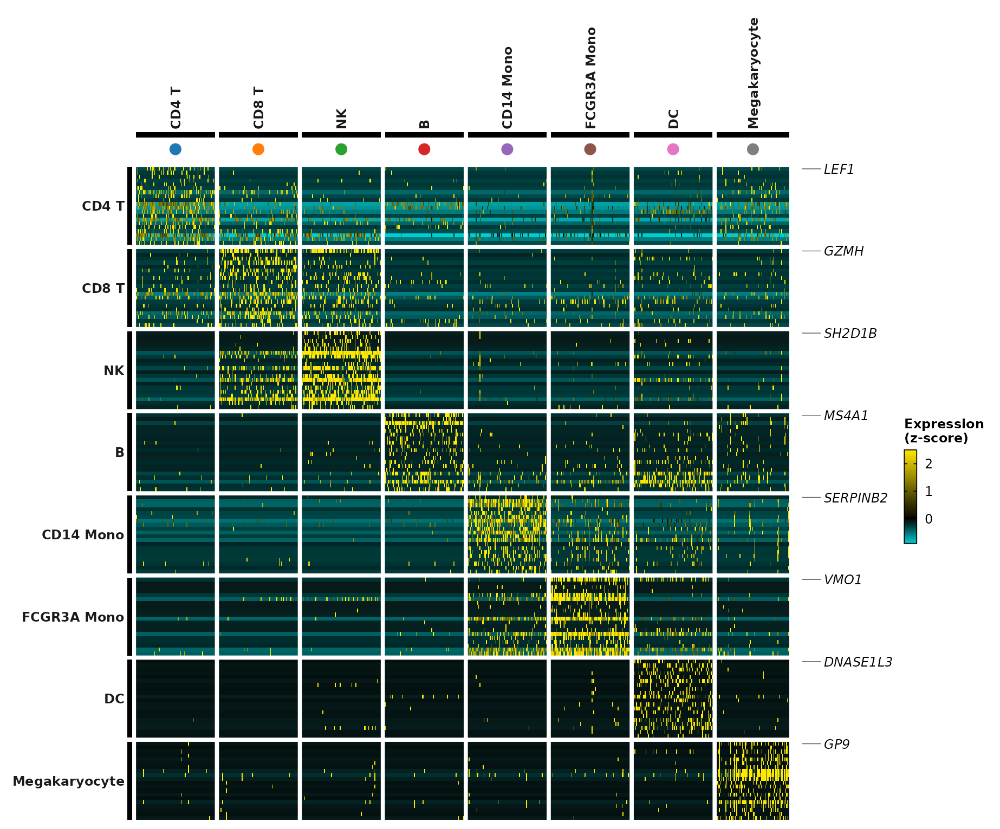
